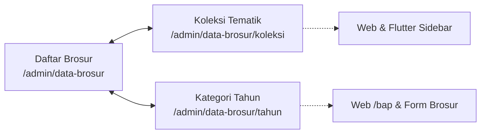
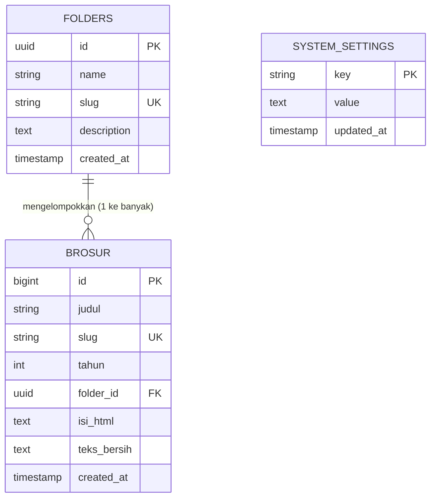

# Dokumentasi Sistem: Interkoneksi Data Brosur, Koleksi Tematik, dan Kategori Tahun

Dokumentasi komprehensif mengenai arsitektur, cara kerja, alur database, serta integrasi multi-platform (Web Next.js & Mobile Flutter) untuk 3 pilar yang saling terkoneksi:
1. **Daftar Brosur Utama**: [`http://localhost:3000/admin/data-brosur`](http://localhost:3000/admin/data-brosur)
2. **Koleksi Tematik**: [`http://localhost:3000/admin/data-brosur/koleksi`](http://localhost:3000/admin/data-brosur/koleksi)
3. **Kategori Tahun Terbit**: [`http://localhost:3000/admin/data-brosur/tahun`](http://localhost:3000/admin/data-brosur/tahun)

---

## 1. Ikhtisar & Arsitektur Koneksi Antar Modul

Ketiga modul ini saling terhubung secara dua arah (bidirectional):

* **Daftar Brosur (`/admin/data-brosur`)**: Menampilkan seluruh data edisi brosur dengan badge tahun dan koleksi yang interaktif (klik untuk filter), filter bar ganda, dan Quick Set/Ubah Koleksi langsung.
* **Koleksi Tematik (`/admin/data-brosur/koleksi`)**: Menampilkan daftar tema/koleksi, jumlah brosur per tema, tombol langsung melihat daftar brosur dalam tema tersebut, serta tombol cepat menambah brosur baru ke tema tersebut (`?folder=ID`).
* **Kategori Tahun (`/admin/data-brosur/tahun`)**: Menampilkan tahun terbit, jumlah edisi brosur per tahun, tombol langsung melihat daftar brosur tahun tersebut, serta tombol cepat menambah brosur baru tahun tersebut (`?tahun=YEAR`).

---

## 2. Arsitektur & Skema Database Supabase

Sistem menggunakan database PostgreSQL di Supabase dengan skema relasional:

### Penjelasan Skema:
1. **Tabel `folders`**:
   * `id` (`uuid`, Primary Key): ID unik koleksi.
   * `name` (`text`): Nama koleksi yang tampil pada UI (misal: "Fiqih Thaharah").
   * `slug` (`text`, Unique): URL slug ramah SEO (misal: "fiqih-thaharah").
   * `description` (`text`, nullable): Keterangan / ruang lingkup tema brosur.
   * `created_at` (`timestamptz`): Waktu pembuatan.

2. **Tabel `brosur`**:
   * `tahun` (`int`): Tahun terbit (digunakan untuk pengelompokan kronologis).
   * `folder_id` (`uuid`, Foreign Key ke `folders.id`, nullable): Relasi ke koleksi tematik. Jika koleksi dihapus, nilai kolom ini disetel ke `NULL` (`ON DELETE SET NULL`) sehingga brosur fisik tidak akan terhapus.

3. **Tabel `system_settings`**:
   * Menyimpan entri dengan key `custom_years`.
   * Format `value`: JSON Array integer `[2027, 2026, 2025, ...]` untuk menyimpan tahun-tahun baru yang ditambahkan oleh admin sebelum edisi brosur pada tahun tersebut diunggah.

---

## 3. Modul Kategori Tahun (`/admin/data-brosur/tahun`)

### 3.1. Fitur Utama
* **Tampilan Tabular / Grid Responsif**: Setiap kartu tahun menampilkan nomor tahun, total edisi brosur yang sudah terbit di tahun tersebut, serta ikon status.
* **Pencarian Tahun Instan**: Pengguna dapat mencari tahun tertentu (contoh: mengetik "2026") secara cepat tanpa perlu me-reload halaman.
* **Paginasi Otomatis**: Daftar tahun dipaginasi secara rapi (8 tahun per halaman) agar antarmuka tetap ringan.
* **Pintasan Aksi (Quick Actions)**:
  * **Lihat Brosur**: Membuka `/admin/data-brosur?tahun={year}` yang langsung memfilter tabel data brosur pada tahun yang dipilih.
  * **Tambah Brosur**: Membuka form pembuatan brosur baru `/admin/data-brosur/new?tahun={year}` dengan tahun terbit yang sudah otomatis terpilih.
  * **Hapus Kategori Tahun Kosong**: Hanya aktif jika tahun tersebut belum memiliki edisi brosur (0 edisi).

### 3.2. Modal Tambah Tahun Baru
1. Admin mengklik tombol **Tambah Tahun** di kanan atas.
2. Sistem otomatis merekomendasikan tahun berikutnya (misal: `2027`).
3. Dilakukan validasi:
   * Harus 4 digit angka yang valid antara rentang `1950` hingga `2100`.
   * Tidak boleh duplikat dengan tahun yang sudah ada.
4. Data disimpan ke `system_settings` (key `custom_years`) dan langsung muncul di dropdown form tambah/edit brosur serta pada halaman arsip publik (`/bap`).

---

## 4. Modul Koleksi Tematik (`/admin/data-brosur/koleksi`)

### 4.1. Fitur Utama
* **Pencarian Nama Koleksi**: Memfilter koleksi tematik berdasarkan kata kunci secara real-time.
* **Opsi Enable / Disable (Visibilitas Publik)**:
  * Admin dapat mengaktifkan (**Enable**) atau menonaktifkan (**Disable**) koleksi secara instan via tombol status di kartu koleksi maupun saat membuat/mengedit koleksi.
  * Koleksi yang berstatus **Nonaktif** otomatis disembunyikan dari:
    * Sidebar Web Publik ([MainSidebar.tsx](file:///Users/rifqiwariyanto/Documents/GitHub/NEXTJS/brosur-ahad-pagi/app/components/MainSidebar.tsx))
    * Katalog Publik ([app/koleksi/page.tsx](file:///Users/rifqiwariyanto/Documents/GitHub/NEXTJS/brosur-ahad-pagi/app/koleksi/page.tsx))
    * Drawer Aplikasi Flutter ([home_drawer.dart](file:///Users/rifqiwariyanto/Documents/GitHub/FLUTTER/pustaka/lib/screens_v2/components/home_drawer.dart))
    * Jika diakses langsung melalui URL publiknya (contoh: `http://localhost:3000/koleksi/maqollah`), akan tampil halaman pemberitahuan bahwa koleksi sedang dinonaktifkan oleh administrator.
* **Counter Otomatis Jumlah Brosur**: Menghitung secara dinamis berapa banyak edisi brosur yang sudah ditautkan ke masing-masing koleksi.
* **Paginasi Grid**: 9 koleksi per halaman dengan navigasi halaman yang fleksibel.
* **Aksi Buka Koleksi**:
  * Tautan langsung ke halaman publik: `/koleksi/[slug]`.
  * Tautan filter admin: `/admin/data-brosur?folder=[folderId]`.

### 4.2. Modal Tambah & Edit Koleksi
* **Nama Koleksi**: Nama tema/topik (wajib diisi).
* **Slug URL**: Terbuat otomatis dari nama koleksi dengan format kebab-case (`koleksi-nama`), namun tetap dapat disesuaikan manual oleh admin.
* **Deskripsi Singkat**: Penjelasan mengenai cakupan tema koleksi.
* **Switch Visibilitas Publik**: Checkbox switch untuk mengatur apakah koleksi langsung aktif di publik atau berstatus draft/nonaktif terlebih dahulu.

### 4.3. Keamanan Penghapusan Koleksi
Saat admin mengklik tombol hapus pada koleksi yang memiliki brosur:
1. Muncul dialog konfirmasi peringatan yang menginformasikan berapa jumlah brosur di dalam koleksi tersebut.
2. Brosur di dalamnya **tidak akan ikut terhapus**. Sistem secara aman mengubah `folder_id` brosur terkait menjadi `NULL` terlebih dahulu, lalu menghapus entri folder dari tabel `folders`.

---

## 5. Integrasi Multi-Platform

Setiap perubahan data pada kedua modul admin ini langsung terhubung secara otomatis ke antarmuka pengguna:

### 5.1. Integrasi Web Next.js (`http://localhost:3000/`)
1. **Sidebar Utama ([MainSidebar.tsx](file:///Users/rifqiwariyanto/Documents/GitHub/NEXTJS/brosur-ahad-pagi/app/components/MainSidebar.tsx))**:
   * Bagian **Koleksi Tematik** memuat daftar koleksi dari Supabase secara langsung.
   * Dilengkapi badge counter jumlah koleksi, collapsible accordion (buka/tutup), dan active link highlighting.
2. **Katalog Koleksi ([app/koleksi/page.tsx](file:///Users/rifqiwariyanto/Documents/GitHub/NEXTJS/brosur-ahad-pagi/app/koleksi/page.tsx))**:
   * Halaman daftar seluruh tema koleksi beserta total edisi brosur di dalamnya.
3. **Detail Koleksi ([app/koleksi/[slug]/page.tsx](file:///Users/rifqiwariyanto/Documents/GitHub/NEXTJS/brosur-ahad-pagi/app/koleksi/[slug]/page.tsx))**:
   * Menampilkan grid brosur dalam koleksi terkait, search filter judul/tahun, dan link baca brosur `/bap/[year]/[slug]`.
4. **Arsip Tahun ([app/bap/page.tsx](file:///Users/rifqiwariyanto/Documents/GitHub/NEXTJS/brosur-ahad-pagi/app/bap/page.tsx))**:
   * Menampilkan daftar tahun yang selalu sinkron dengan data tahun di admin.

### 5.2. Integrasi Mobile Flutter (`pustaka`)
1. **Drawer Samping ([home_drawer.dart](file:///Users/rifqiwariyanto/Documents/GitHub/FLUTTER/pustaka/lib/screens_v2/components/home_drawer.dart))**:
   * Menampilkan section **KOLEKSI TEMATIK** di bawah menu utama dengan badge jumlah dan ikon toggle.
   * Mendukung sinkronisasi online Supabase serta fallback offline cache (`CacheHelper`).
2. **Layar Koleksi Brosur ([brosur_collection_screen_v2.dart](file:///Users/rifqiwariyanto/Documents/GitHub/FLUTTER/pustaka/lib/screens_v2/brosur_collection_screen_v2.dart))**:
   * Ketika salah satu koleksi di drawer diklik, aplikasi membuka daftar brosur dalam tema tersebut, dilengkapi input pencarian dan navigasi ke `DetailBrosurScreenV2`.

---

## 6. Panduan Penggunaan Operasional

### Cara Menambah Tahun Terbit Baru
1. Buka [http://localhost:3000/admin/data-brosur/tahun](http://localhost:3000/admin/data-brosur/tahun).
2. Klik tombol **Tambah Tahun** di sudut kanan atas.
3. Masukkan 4 angka tahun (misal: `2027`).
4. Klik **Simpan Tahun**.
5. Kategori tahun baru akan langsung tersedia di dropdown form upload brosur dan halaman publik.

### Cara Menambah Koleksi Tematik Baru
1. Buka [http://localhost:3000/admin/data-brosur/koleksi](http://localhost:3000/admin/data-brosur/koleksi).
2. Klik tombol **Tambah Koleksi**.
3. Masukkan **Nama Koleksi** (contoh: `Kajian Sholat Khusyuk`).
4. Periksa **Slug URL** (otomatis terisi `kajian-sholat-khusyuk`).
5. (Opsional) Tuliskan **Deskripsi Singkat**.
6. Klik **Simpan Koleksi**.
7. Koleksi otomatis muncul di Sidebar Web dan Flutter Drawer.

### Cara Memasukkan Brosur ke Koleksi
1. Buka [http://localhost:3000/admin/data-brosur](http://localhost:3000/admin/data-brosur).
2. Edit brosur yang diinginkan atau klik **Tambah Brosur**.
3. Pada dropdown **Koleksi Tematik**, pilih koleksi yang sesuai.
4. Klik **Simpan**.
