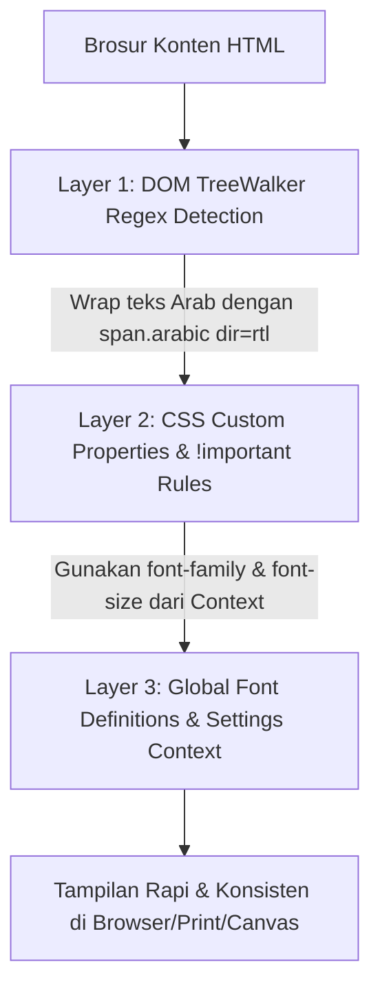

# Arsitektur Pembacaan Data & Konsistensi Tipografi (Arab & Latin) pada Halaman Detail Brosur (`app/bap`)

Dokumen ini menjelaskan secara teknis dan komprehensif bagaimana halaman detail brosur di Next.js (`app/bap/[year]/[slug]`) membaca data dari basis data (Supabase) serta bagaimana sistem menjamin **konsistensi font Arabic & Latin** di seluruh konten brosur.

---

## 1. Alur Pembacaan Data (Data Fetching Flow)

### 1.1 Struktur Routing & Dynamic Route
Halaman detail berada pada path:
```text
app/bap/[year]/[slug]/page.tsx
```
* **Dynamic Segments:**
  * `[year]`: Menunjukkan tahun brosur (misalnya `2024`, `1985`).
  * `[slug]`: Slug unik dokumen brosur (contoh: `BAP-(Brosur-Ahad-Pagi)-1985-01-06-kewadjiban-berdjamaah`).

### 1.2 Resolusi Slug & Fuzzy Search di Server Component
File [`page.tsx`](file:///Users/rifqiwariyanto/Documents/GitHub/NEXTJS/brosur-ahad-pagi/app/bap/%5Byear%5D/%5Bslug%5D/page.tsx) adalah Server Component Next.js (`dynamic = 'force-dynamic'`).

1. **URL Decoding & Sanitasi:**
   ```typescript
   const resolvedParams = await params;
   const slug = decodeURIComponent(resolvedParams.slug);
   const searchSlug = slug.replace('BAP-(Brosur-Ahad-Pagi)-', '').trim();
   ```
2. **Kueri Supabase (Fuzzy Match):**
   ```typescript
   const supabase = await createClient();
   const { data: brosur } = await supabase
     .from('brosur')
     .select('*')
     .ilike('slug', `%${searchSlug}%`)
     .limit(1)
     .maybeSingle();
   ```
   * Menggunakan `ilike` dengan wildcard `%...%` untuk mengantisipasi ketidaksamaan format slug, spasi tersembunyi, atau inkonsistensi prefiks.
3. **Penyajian Data ke Komponen Client:**
   Setelah data brosur (`brosur.konten`, `brosur.judul`, `brosur.tahun`, `brosur.slug`) diperoleh, data dioper ke komponen Client:
   ```tsx
   <HighlightClient brosur={brosur} />
   ```

---

## 2. Pembersihan & Render HTML Mentah

Brosur bersumber dari file legacy / CHM HTML yang memiliki tag bawaan (`<style>`, inline style lama, dan struktur teks campuran).

### 2.1 Sanitasi Awal (Inline Style & Style Block)
Di [`HighlightClient.tsx`](file:///Users/rifqiwariyanto/Documents/GitHub/NEXTJS/brosur-ahad-pagi/app/bap/%5Byear%5D/%5Bslug%5D/HighlightClient.tsx#L322):
```tsx
dangerouslySetInnerHTML={{
  __html: brosur.konten
    .replace(/<style[^>]*>[\s\S]*?<\/style>/gi, '')
    .replace(/html,body\s*\{[\s\S]*?\}/gi, '')
}}
```
Ini mencegah CSS internal dari file HTML lama merusak layout Next.js.

---

## 3. Konsistensi Font Latin & Arabic

Tantangan utama pada dokumen kajian adalah **percampuran teks Indonesia (Latin) dan teks ayat/hadits (Arab)** di dalam satu paragraf tanpa tag khusus dari sumber dokumen aslinya.

Sistem mengatasi ini melalui **3 Layer Proteksi**:



### Layer 1: Deteksi Dinamis & DOM TreeWalker (Client-Side)
Saat komponen `HighlightClient` di-mount, browser menjalankan DOM TreeWalker yang menelusuri seluruh text node:

```typescript
// Regex rentang Unicode huruf Arab & tanda baca / harakat
const arabicDetectRegex = /[\u0600-\u06FF\u0750-\u077F\u08A0-\u08FF\uFB50-\uFDFF\uFE70-\uFEFF\u061C]/;

// Regex untuk membungkus kalimat Arab dan tanda baca di antaranya
const arabicReplaceRegex = /([\u0600-\u06FF\u0750-\u077F\u08A0-\u08FF\uFB50-\uFDFF\uFE70-\uFEFF\u061C]+(?:[\s\W\d]{0,15}?[\u0600-\u06FF\u0750-\u077F\u08A0-\u08FF\uFB50-\uFDFF\uFE70-\uFEFF\u061C]+)*)/g;
```

**Mekanisme Kerja:**
1. Hanya mencari node teks murni (`NodeFilter.SHOW_TEXT`), sehingga aman dari merusak atribut tag HTML.
2. Mengecek apakah node belum berada di dalam wrapper Arab (`!parent.closest('.arabic, [dir="rtl" i], [lang^="ar" i]')`).
3. Mengganti string Arab menjadi:
   ```html
   <span class="arabic inline-block" dir="rtl">...teks Arab...</span>
   ```

### Layer 2: Penegakan Aturan CSS (`globals.css`)
Pada [`app/globals.css`](file:///Users/rifqiwariyanto/Documents/GitHub/NEXTJS/brosur-ahad-pagi/app/globals.css#L25-L45), dibuat selektor spesifik dengan `!important` untuk menimpa semua sisa format bawaan Word/CHM:

#### A. Khusus Teks Latin:
```css
.reader-content, 
.reader-content p, 
.reader-content li, 
.reader-content span:not([dir="rtl"]):not(.arabic):not([lang^="ar" i]):not([style*="Arabic" i]) {
  font-family: var(--font-inter), ui-sans-serif, system-ui, sans-serif !important;
  font-size: var(--base-font-size, 16px) !important;
  line-height: 1.8 !important;
}
```
* Menjamin teks terjemahan, catatan kaki, dan penjelasan selalu menggunakan **Inter** dengan ukuran proporsional.

#### B. Khusus Teks Arabic:
```css
.reader-content [lang="AR-SA" i],
.reader-content [dir="rtl" i],
.reader-content [lang="AR-EG" i],
.reader-content [lang="ar" i],
.reader-content font[face*="Arabic" i],
.reader-content [style*="Arabic" i],
.reader-content .arabic {
  font-family: var(--font-amiri), 'Amiri', serif !important;
  font-size: var(--arabic-font-size, 32px) !important;
  line-height: 2.5 !important;
  display: inline-block;
  direction: rtl;
}
```
* Menangkap semua atribut legacy (`lang="AR-SA"`, `font face="Traditional Arabic"`) sekaligus class `.arabic` yang dibuat oleh TreeWalker.
* Menggunakan `line-height: 2.5` agar harakat / tanda baca atas-bawah tidak bertumpuk atau terpotong.

---

### Layer 3: Pengaturan Pengguna Dinamis (`SettingsContext`)
Pengguna dapat mengatur preferensi ukuran dan jenis font secara realtime melalui popover pengaturan:

1. **State Tersedia:**
   * `latinFontSize` (default: 18px)
   * `arabicFontSize` (default: 28px)
   * `latinFontFamily` (`sans-serif` atau `serif`)
   * `arabicFontFamily` (`amiri` atau `traditional-arabic`)
2. **Penyimpanan:**
   Tersimpan otomatis ke `localStorage ('bap-settings')`.
3. **Injeksi Variabel CSS Inline:**
   Di [`HighlightClient.tsx`](file:///Users/rifqiwariyanto/Documents/GitHub/NEXTJS/brosur-ahad-pagi/app/bap/%5Byear%5D/%5Bslug%5D/HighlightClient.tsx#L317-L321):
   ```tsx
   style={{
     '--base-font-size': `${latinFontSize}px`,
     '--arabic-font-size': `${arabicFontSize}px`,
     '--arabic-font-family': arabicFontFamily === 'amiri' 
       ? "var(--font-amiri), serif" 
       : "'Traditional Arabic', var(--font-trad-arabic), 'KFGQPC Uthmanic Script HAFS', Arial, serif",
   } as React.CSSProperties}
   ```

---

## 4. Fitur Tambahan Terintegrasi

| Fitur | Implementasi |
| :--- | :--- |
| **Search Highlight & Scroll** | Menggunakan library `mark.js` untuk query pencarian (`?q=...`) dan DOM traversal untuk parameter `?scroll=...`. |
| **Simpan sebagai Gambar (Canvas)** | Menggunakan `html2canvas` pada elemen `#reader-content` dengan `scale: 2` (HD). Font Arab dan Latin tetap terjaga karena di-render langsung dari node DOM yang sudah terstandarisasi. |
| **Cetak / PDF** | `@media print` rules di [`globals.css`](file:///Users/rifqiwariyanto/Documents/GitHub/NEXTJS/brosur-ahad-pagi/app/globals.css#L47-L55) menghapus URL bawaan browser, menyetel padding bersih `2cm`, dan menyembunyikan tombol floating share. |
