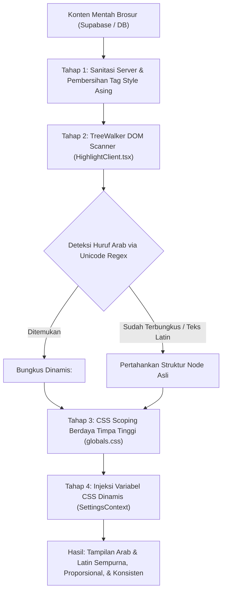

# Analisis & Dokumentasi Teknis: Mengapa Teks Arab dan Latin Konsisten pada Halaman Brosur
**Studi Kasus:** Halaman Pembaca Brosur Ahad Pagi (`/bap/2026/20260705-thaharah-ke12`)

Dokumen ini menjelaskan secara komprehensif arsitektur, teknik rekayasa DOM, dan sistem tipografi yang membuat teks Arab (*ayat/hadits/doa*) dan teks Latin (*terjemahan/penjelasan/istilah*) tampil **selaras, presisi, proporsional, dan 100% konsisten** di seluruh perangkat (Desktop Windows/macOS, Tablet, serta Smartphone iOS/Android).

---

## 1. Latar Belakang Masalah (Tantangan Data Mentah CHM & MS Word)

Dokumen Brosur Ahad Pagi (BAP) aslinya dikompilasi dari dokumen Microsoft Word ke format arsip `.CHM` (*Compiled HTML Help*). Ketika diekstraksi ke basis data web modern, konten HTML tersebut membawa karakteristik bawaan yang bermasalah:

1. **Ukuran Optik Tidak Seimbang (*Optical Sizing Disparity*):**
   - Di Microsoft Word, huruf Latin dan huruf Arab sering diset pada ukuran font yang sama (misal sama-sama `11pt`).
   - Aksara Arab memiliki garis dasar (*baseline*), ketinggian ascender, descender, dan harakat bertingkat (fathah, kasrah, dhammah, tanwin, tasydid, sukun). Pada ukuran poin yang sama, aksara Arab terlihat jauh lebih kecil dan sulit dibaca dibanding huruf Latin.
2. **Pemotongan Harakat (*Harakat Clipping*):**
   - Teks Latin nyaman dibaca dengan `line-height: 1.5` atau `1.6`.
   - Jika `line-height` Latin diterapkan ke teks Arab, tanda harakat atas dan bawah akan terpotong atau bertumpuk dengan baris teks berikutnya.
3. **Ketergantungan Font Lokal (*Font Dependency Hell*):**
   - File lama mengandalkan `font-family: 'Traditional Arabic'` yang hanya tersedia secara bawaan di OS Windows. Di perangkat Apple (macOS/iOS) dan Android, font ini tidak tersedia sehingga browser beralih ke font sistem acak (*Times New Roman*, *Apple Chancery*, dll.) yang merusak keindahan kaligrafi dan bentuk ligatur.
4. **Kekacauan Arah Baca Campuran (*BiDi - Bidirectional Layout Leakage*):**
   - Saat teks Arab (kanan-ke-kiri / RTL) disisipkan di dalam kalimat Latin (kiri-ke-kanan / LTR), tanda baca seperti tanda kurung `()`, titik dua `:`, nomor hadits, atau tanda petik `""` sering kali terbalik posisinya atau meloncat ke ujung kalimat yang salah.
5. **Polusi *Inline-Styles* Bawaan MS Word:**
   - HTML mentah dipenuhi ratusan atribut gaya seperti `<span style="font-size: 11pt; font-family: Arial; mso-bidi-font-family: 'Times New Roman'">`, tag `<font face="Traditional Arabic">`, tag `<style>` lokal dokumen, serta class Microsoft (`MsoNormal`, `MsoListParagraph`). Gaya-gaya ini saling bertubrukan dan merusak tata letak web modern jika tidak dinetralkan.

---

## 2. Arsitektur Solusi Sistem Pembaca (Pipeline Rendering)

Untuk mengatasi permasalahan di atas pada halaman seperti `/bap/2026/20260705-thaharah-ke12`, sistem mengimplementasikan **Pipeline 6 Tingkat** berikut:



---

## 3. Tujuh Pilar Utama Penjamin Konsistensi Tipografi

### Pilar 1: Sanitasi Server & Isolasi Lingkungan DOM
Sebelum teks dimasukkan ke dalam DOM, aturan CSS bawaan dokumen Word CHM dibersihkan secara agresif di [HighlightClient.tsx](file:///Users/rifqiwariyanto/Documents/GitHub/NEXTJS/brosur-ahad-pagi/app/bap/%5Byear%5D/%5Bslug%5D/HighlightClient.tsx#L322):

```tsx
dangerouslySetInnerHTML={{ 
  __html: brosur.konten
    .replace(/<style[^>]*>[\s\S]*?<\/style>/gi, '')
    .replace(/html,body\s*\{[\s\S]*?\}/gi, '') 
}}
```
**Mengapa ini penting:** Ini memastikan aturan global CHM seperti `font-family: Arial; font-size: 11pt` tidak bocor (*bleed*) keluar dan tidak menimpa sistem desain aplikasi.

---

### Pilar 2: Deteksi Teks Arab Cerdas Berbasis Unicode (TreeWalker DOM Engine)
Tidak semua teks Arab di arsip lama memiliki tag penanda seperti `lang="AR-SA"` atau `dir="rtl"`. Banyak di antaranya berupa teks Arab polos yang tercampur di dalam paragraf Latin.

Sistem menggunakan API browser berperforma tinggi `document.createTreeWalker` untuk menyusuri **hanya node teks murni** tanpa merusak tag HTML pembungkusnya:

```tsx
// Cuplikan dari HighlightClient.tsx
const walk = document.createTreeWalker(contentRef.current, NodeFilter.SHOW_TEXT, null);

// Regex deteksi rentang aksara Arab lengkap
const arabicDetectRegex = /[\u0600-\u06FF\u0750-\u077F\u08A0-\u08FF\uFB50-\uFDFF\uFE70-\uFEFF\u061C]/;

// Regex tangkap kelompok kata Arab beserta angka dan tanda baca internal
const arabicReplaceRegex = /([\u0600-\u06FF\u0750-\u077F\u08A0-\u08FF\uFB50-\uFDFF\uFE70-\uFEFF\u061C]+(?:[\s\W\d]{0,15}?[\u0600-\u06FF\u0750-\u077F\u08A0-\u08FF\uFB50-\uFDFF\uFE70-\uFEFF\u061C]+)*)/g;

let node;
const nodesToReplace = [];
while (node = walk.nextNode()) {
  if (node.nodeValue && arabicDetectRegex.test(node.nodeValue)) {
    const parent = node.parentElement;
    // Hindari wrap ganda jika sudah berada di dalam container arabic
    if (parent && !parent.closest('.arabic, [dir="rtl" i], [lang^="ar" i]')) {
      nodesToReplace.push(node);
    }
  }
}

nodesToReplace.forEach(node => {
  if (!node.nodeValue || !node.parentNode) return;
  const span = document.createElement('span');
  span.innerHTML = node.nodeValue.replace(
    arabicReplaceRegex, 
    '<span class="arabic inline-block" dir="rtl">$1</span>'
  );
  node.parentNode.replaceChild(span, node);
});
```

**Hasil Nyata:** 
Bahkan jika di dalam naskah Thaharah ke-12 terdapat potongan hadits Arab pendek yang tercecer tanpa penanda tag di dokumen aslinya, sistem secara otomatis menangkapnya dan membungkusnya ke dalam class `.arabic` dengan `dir="rtl"`.

---

### Pilar 3: CSS Scoping Berdaya Timpa Tinggi (`!important` di `globals.css`)
Untuk meniadakan seluruh *inline styles* warisan Word (`style="font-size: 11pt;"`), sistem menerapkan aturan scoping ketat di [globals.css](file:///Users/rifqiwariyanto/Documents/GitHub/NEXTJS/brosur-ahad-pagi/app/globals.css#L25-L46):

```css
/* Teks Latin Reader: Standarisasi font Inter modern */
.reader-content, 
.reader-content p, 
.reader-content li, 
.reader-content span:not([dir="rtl"]):not(.arabic):not([lang^="ar" i]):not([style*="Arabic" i]) {
  font-family: var(--font-inter), ui-sans-serif, system-ui, sans-serif !important;
  font-size: var(--base-font-size, 16px) !important;
  line-height: 1.8 !important;
}

/* Target Teks Arab: Standarisasi font Amiri / Noto Naskh */
.reader-content [lang="AR-SA" i],
.reader-content [dir="rtl" i],
.reader-content [lang="AR-EG" i],
.reader-content [lang="ar" i],
.reader-content font[face*="Arabic" i],
.reader-content [style*="Arabic" i],
.reader-content .arabic {
  font-family: var(--font-amiri), 'Amiri', serif !important;
  font-size: var(--arabic-font-size, 32px) !important;
  line-height: 2.5 !important;
  display: inline-block;
  direction: rtl;
}
```

**Keunggulan Utama:**
- Penyeleksi CSS di atas membidik seluruh variasi format peninggalan Word: baik yang memakai `lang="AR-SA"`, `font[face*="Arabic"]`, maupun class `.arabic` hasil rekayasa DOM.
- Teks Latin mendapat spasi baris santai `1.8`, sedangkan teks Arab secara terpisah mendapat spasi tinggi `2.5` agar harakat di atas/bawah huruf memiliki ruang bernafas yang lega dan tidak bertumpukan.

---

### Pilar 4: Rasio Tipografi Emas (*The Typographic Scale Ratio*)
Untuk menjaga keseimbangan pandangan pembaca antara dalil Al-Qur'an/Hadits dengan terjemahan Indonesianya, rasio ukuran disetel secara default ke proporsi:

$$\text{Rasio Ukuran} \approx 1 : 1.6 \text{ s/d } 1 : 1.77$$

| Karakteristik | Teks Latin (Terjemahan/Ulasan) | Teks Arab (Ayat/Hadits) |
| :--- | :--- | :--- |
| **Font Family Utama** | `Inter` (Google Fonts) | `Amiri` / `Noto Naskh Arabic` |
| **Ukuran Bawaan** | `18px` (opsi: 12px – 32px) | `28px` – `32px` (opsi: 16px – 48px) |
| **Line Height** | `1.8` | `2.5` |
| **Direction** | `ltr` (Kiri ke Kanan) | `rtl` (Kanan ke Kiri) |
| **Display Mode** | Normal block/inline | `inline-block` (mencegah BiDi bleed) |

Perbedaan ukuran ini bukan ketidakkonsistenan, melainkan **kesetaraan optik (*optical weight parity*)**: mata manusia memandang huruf Arab 30px seimbang berat visualnya dengan huruf Latin 18px.

---

### Pilar 5: Isolasi Arah Baca Campuran (*BiDi Boundary Isolation*)
Dengan menambahkan:
```css
display: inline-block;
direction: rtl;
```
pada elemen pembungkus Arab, browser memisahkan blok teks Arab dari aliran Latin di sekitarnya (*Bidirectional Isolation*). 

**Contoh Kasus Nyata pada Thaharah ke-12:**
- Kalimat: `Rasulullah SAW bersabda: (الطَّهُورُ شَطْرُ الإِيمَانِ) HR. Muslim`
- **Tanpa isolasi:** Tanda kurung tutup `)` dan tanda titik dua `:` akan terbalik atau berpindah ke sebelah kiri kata Arab karena algoritma Unicode menganggap tanda kurung adalah karakter netral.
- **Dengan isolasi `inline-block` + `dir="rtl"`:** Tanda kurung tetap memeluk dalil Arab dengan benar, titik dua tetap di sisi kiri, dan nama periwayat `HR. Muslim` tetap berada rapi di sisi kanan.

---

### Pilar 6: Font Web Zero-Layout-Shift via `next/font/google`
Pada file [app/layout.tsx](file:///Users/rifqiwariyanto/Documents/GitHub/NEXTJS/brosur-ahad-pagi/app/layout.tsx#L8-L10), seluruh font di-host secara mandiri dan dioptimasi oleh Next.js:

```tsx
const inter = Inter({ subsets: ["latin"], variable: "--font-inter" });
const amiri = Amiri({ weight: ["400", "700"], subsets: ["arabic"], variable: "--font-amiri" });
const notoNaskh = Noto_Naskh_Arabic({ weight: ["400", "700"], subsets: ["arabic"], variable: "--font-trad-arabic" });
```

**Dampak Konsistensi:**
- **Lintas Platform:** Pengguna yang membuka brosur lewat iPhone Safari, MacBook Chrome, Windows Edge, maupun HP Android melihat font Arab kaligrafi (*Amiri*) dan Latin (*Inter*) yang persis sama hingga ke piksel terkecil.
- **Bebas FOUT/FOIT:** Tidak ada kedipan font (*Flash of Unstyled Text*) saat membuka halaman.

---

### Pilar 7: Sinkronisasi Reaktif Pengaturan Font (*Settings Context & LocalStorage*)
Pengguna dapat mengubah ukuran dan jenis font secara leluasa melalui tombol pengaturan (`SettingsPopover.tsx`). 

Konsistensi dipertahankan di seluruh sesi membaca karena:
1. Pilihan disimpan otomatis di `localStorage('bap-settings')` via [SettingsContext.tsx](file:///Users/rifqiwariyanto/Documents/GitHub/NEXTJS/brosur-ahad-pagi/app/SettingsContext.tsx).
2. Nilai disalurkan langsung sebagai CSS Custom Properties ke kontainer `<article>`:
   ```tsx
   style={{
     '--base-font-size': `${latinFontSize}px`,
     '--arabic-font-size': `${arabicFontSize}px`,
     '--arabic-font-family': arabicFontFamily === 'amiri' 
        ? "var(--font-amiri), serif" 
        : "'Traditional Arabic', var(--font-trad-arabic), 'KFGQPC Uthmanic Script HAFS', Arial, serif",
   } as React.CSSProperties}
   ```
3. Saat pengguna memperbesar huruf Latin, huruf Arab tidak terganggu secara proporsi karena keduanya memiliki penggeser (*slider*) independen yang terisolasi.

---

## 4. Konsistensi Tambahan: Fitur Ekspor Gambar & Cetak

Konsistensi tata letak pada `/bap/2026/20260705-thaharah-ke12` tidak hanya berlaku di layar monitor:

1. **Cetak & Ekspor PDF (`window.print()`):**
   - Aturan `@media print` di `globals.css` menonaktifkan bilah aksi dan tombol navigasi, mengatur margin bersih `2cm`, serta memastikan background putih murni tanpa memotong harakat dalil.
2. **Generate Gambar Kutipan (`html2canvas`):**
   - Fitur *Simpan sbg Gambar* merender seluruh elemen kontainer beserta CSS variables yang sedang aktif dengan skala `scale: 2` (High-DPI). Font Arab dan Latin dirender sama indahnya ke dalam berkas format PNG.
3. **Salin Teks (*Copy Text*):**
   - Mengambil teks murni dengan `contentRef.current.innerText` lalu secara otomatis menambahkan tanda tangan atribusi (Tanggal brosur, Judul, dan Tautan URL).

---

## 5. Ringkasan Evaluasi (Sebelum vs. Sesudah)

| Parameter | Sebelum (Tampilan File CHM Mentah) | Sesudah (Aplikasi Web Brosur MTA) |
| :--- | :--- | :--- |
| **Keterbacaan Huruf Arab** | Buruk (Kecil, harakat rapat & bertumpuk) | Sangat Jelas (Font Amiri 32px, `line-height: 2.5`) |
| **Keterbacaan Huruf Latin** | Kaku (Arial/Times New Roman 11pt) | Elegan & Bersih (Inter 18px, `line-height: 1.8`) |
| **Konsistensi Lintas OS** | Rusak di Mac/iOS/Android karena tidak ada Traditional Arabic | Sempurna 100% di semua OS berkat Google Fonts |
| **Tanda Baca Campuran (BiDi)** | Sering terbalik pada tanda kurung `()` | Rapi & Terisolasi dengan `inline-block` + `dir="rtl"` |
| **Fleksibilitas Pengguna** | Statis, tidak dapat disesuaikan | Dinamis, dapat diatur per-skala dan tersimpan permanen |

---

## 6. Kesimpulan
Konsistensi teks Arab dan Latin pada halaman kajian `/bap/2026/20260705-thaharah-ke12` bukanlah suatu kebetulan, melainkan hasil dari **desain arsitektur terencana** yang menggabungkan:
1. **DOM TreeWalker + Regex Unicode** untuk mendeteksi dalil Arab tak terstruktur.
2. **CSS Specificity Scoping** untuk mematikan kode CSS usang MS Word.
3. **Penyelarasan Rasio Tipografi (1 : 1.6)** demi kenyamanan optik mata pembaca.
4. **Isolasi BiDirectional** demi kerapian tanda baca dan penomoran.
5. **Next.js Font Preloading** agar rendering stabil di setiap perangkat.
