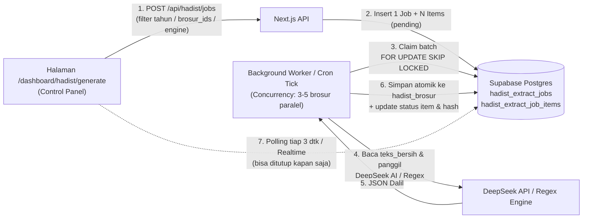

# Analisis & Arsitektur Generator Ekstraksi Hadits Background (`/dashboard/hadist/generate`)

Dokumen ini menganalisis kelemahan mekanisme generator ekstraksi dalil (Al-Qur'an & Hadits) saat ini pada halaman `/dashboard/hadist/generate`, menjawab apakah prosesnya bisa berjalan **di background (tetap jalan meski browser ditutup)**, serta memaparkan rancangan arsitektur dan langkah implementasinya agar lebih **cepat, hemat, aman masuk database, dan anti-gagal**.

---

## 1. Analisis Kondisi Saat Ini & Bottleneck

Berdasarkan implementasi di [app/dashboard/hadist/generate/page.tsx](file:///Users/rifqiwariyanto/Documents/GitHub/NEXTJS/brosur-ahad-pagi/app/dashboard/hadist/generate/page.tsx), [app/api/hadist/generate-ai/route.ts](file:///Users/rifqiwariyanto/Documents/GitHub/NEXTJS/brosur-ahad-pagi/app/api/hadist/generate-ai/route.ts), dan [app/api/hadist/items/route.ts](file:///Users/rifqiwariyanto/Documents/GitHub/NEXTJS/brosur-ahad-pagi/app/api/hadist/items/route.ts):

| Aspek | Kondisi Sekarang | Dampak / Masalah |
| :--- | :--- | :--- |
| **Eksekusi Massal** | Loop `for` dijalankan **di browser (client-side)** satu per satu (`handleMassGenerate`) | Jika tab ditutup, refresh, internet putus, atau laptop sleep, proses **langsung berhenti total**. |
| **Kecepatan** | **Serial (1 brosur per request)**. 1 brosur DeepSeek ≈ 8–20 detik | Untuk 1.500 brosur butuh **3,5 – 8 jam nonstop** dengan tab browser wajib terbuka. |
| **Transfer Data** | Browser mengunduh semua `teks_bersih` lalu mengirim ulang `teks_bersih` ke `/api/hadist/generate-ai` | Boros bandwidth & memori browser, padahal `teks_bersih` sudah ada di database `brosur`. |
| **Tracking Hash** | Semua hash brosur disimpan dalam **1 baris JSON** di `system_settings` (`hadist_extract_hashes`) | **Rentan race condition** jika berjalan paralel (read-modify-write saling menimpa). |
| **Error & Retry** | Jika DeepSeek timeout / 429 / JSON rusak, hanya `console.error` dan lanjut | Tidak ada daftar brosur gagal yang jelas dan tidak ada retry otomatis. |
| **Mode Regex Lokal** | Semua hasil ditumpuk dulu di state React `draftHadists`, baru disimpan manual di akhir | Rawan hang di browser untuk ratusan brosur dan hasil hilang jika belum klik Simpan. |
| **Transaksi DB** | Insert + Delete dipisah di layer HTTP | Sudah diamankan dengan *insert-then-delete*, namun idealnya atomik di level database (RPC/transaksi). |

---

## 2. Apakah Bisa Berjalan di Background (Browser Boleh Ditutup)?

**YA, SANGAT BISA.**

Kuncinya adalah memindahkan *loop eksekusi* dari **browser** ke **server/worker berbasis antrean di database (Postgres/Supabase)**. Browser hanya bertugas sebagai **Control Panel** untuk:
1. Membuat *Job* (antrean brosur yang mau diekstrak).
2. Memantau progres (*live progress bar*, jumlah sukses/gagal/skip).
3. Menekan tombol **Pause / Resume / Retry Gagal / Cancel**.

Saat tab browser ditutup, worker di server tetap membaca antrean dari database, memanggil DeepSeek/Regex, dan menyimpan hasilnya langsung ke tabel `hadist_brosur`. Saat browser dibuka kembali, UI otomatis menampilkan progres terakhir dari database.

---

## 3. Perbandingan 3 Opsi Arsitektur Background

### Opsi A: Database Queue (Supabase/Postgres) + Worker / Cron *(Rekomendasi Utama)*
Menggunakan tabel antrean di Postgres sendiri (`hadist_extract_jobs` & `hadist_extract_job_items`) dengan mekanisme **`FOR UPDATE SKIP LOCKED`** (standar industri, tanpa Redis/service tambahan).

Cara worker menjalankannya menyesuaikan tempat deploy:
1. **Jika deploy di VPS / Docker / Server Node (termasuk lokal / self-hosted):**
   - Jalankan 1 script worker ringan (`scripts/hadist-worker.ts`) via **PM2** atau **systemd** (atau background worker di Node process).
   - Worker polling antrean tiap 3 detik dan memproses **3–5 brosur paralel**.
   - Tidak ada batas timeout HTTP.
2. **Jika deploy di Cloudflare Pages / Vercel (Serverless):**
   - Pasang **Cron Trigger** (Cloudflare Cron / Vercel Cron / `pg_cron` Supabase) tiap 1 menit yang memanggil endpoint `POST /api/hadist/worker/tick` (dilindungi `CRON_SECRET`).
   - Setiap *tick* mengambil **3–5 item `pending`** dan memprosesnya paralel (~15–25 detik), lalu berhenti sebelum batas timeout serverless.

- **Kelebihan:** 100% gratis, nol vendor lock-in, tahan restart/crash, progres & log error tersimpan rapi di Postgres, mendukung Pause/Resume/Retry.
- **Kekurangan:** Perlu 2 tabel baru + 1 script worker atau 1 cron trigger.

### Opsi B: Supabase `pg_cron` + `pg_net` + Edge Function
Postgres sendiri yang menembak endpoint/Edge Function tiap menit lewat ekstensi `pg_cron` + `pg_net`.
- **Kelebihan:** Tetap berjalan meski aplikasi Next.js sedang tidak menerima trafik.
- **Kekurangan:** Debugging lebih sulit di Supabase Edge Function dan ada limit timeout per eksekusi.

### Opsi C: Managed Queue Service (Inngest / Trigger.dev / Upstash QStash)
Menggunakan layanan queue eksternal yang memanggil balik endpoint Next.js secara otomatis.
- **Kelebihan:** Auto-retry, rate-limiting, concurrency, dan dashboard monitoring sudah jadi.
- **Kekurangan:** Menambah ketergantungan & kuota/biaya layanan pihak ketiga.

> **Kesimpulan:** Karena proyek ini sudah menggunakan **Supabase (Postgres)** dan Node/Next.js, **Opsi A (Postgres Queue + Worker/Cron)** adalah pilihan paling efektif, paling murah (Rp 0 biaya infra tambahan), dan paling mudah di-maintain.

---

## 4. Arsitektur Target yang Direkomendasikan



---

## 5. Rancangan Implementasi Lengkap

### 5.1. Skema Database Baru (SQL Migration)

Buat migrasi baru di `supabase/migrations/` untuk menyimpan antrean job dan status per brosur (menggantikan 1 JSON besar di `system_settings` yang rawan race condition):

```sql
-- 1. Tabel induk Job Ekstraksi (1 sesi mass-generate = 1 baris)
CREATE TABLE IF NOT EXISTS public.hadist_extract_jobs (
  id UUID PRIMARY KEY DEFAULT gen_random_uuid(),
  engine TEXT NOT NULL DEFAULT 'deepseek' CHECK (engine IN ('deepseek', 'regex')),
  target_status TEXT NOT NULL DEFAULT 'terverifikasi' CHECK (target_status IN ('terverifikasi', 'mentah')),
  force_regenerate BOOLEAN NOT NULL DEFAULT FALSE,
  status TEXT NOT NULL DEFAULT 'queued' CHECK (status IN ('queued', 'running', 'paused', 'completed', 'cancelled', 'failed')),
  total_items INT NOT NULL DEFAULT 0,
  processed_items INT NOT NULL DEFAULT 0,
  success_items INT NOT NULL DEFAULT 0,
  skipped_items INT NOT NULL DEFAULT 0,
  failed_items INT NOT NULL DEFAULT 0,
  total_dalil_saved INT NOT NULL DEFAULT 0,
  filter_meta JSONB DEFAULT '{}'::jsonb,
  created_at TIMESTAMPTZ NOT NULL DEFAULT now(),
  started_at TIMESTAMPTZ,
  finished_at TIMESTAMPTZ,
  updated_at TIMESTAMPTZ NOT NULL DEFAULT now()
);

-- 2. Tabel item antrean per brosur
CREATE TABLE IF NOT EXISTS public.hadist_extract_job_items (
  id UUID PRIMARY KEY DEFAULT gen_random_uuid(),
  job_id UUID NOT NULL REFERENCES public.hadist_extract_jobs(id) ON DELETE CASCADE,
  brosur_id UUID NOT NULL,
  status TEXT NOT NULL DEFAULT 'pending' CHECK (status IN ('pending', 'processing', 'done', 'skipped', 'failed')),
  attempts INT NOT NULL DEFAULT 0,
  max_attempts INT NOT NULL DEFAULT 3,
  dalil_count INT NOT NULL DEFAULT 0,
  content_hash TEXT,
  error_message TEXT,
  locked_at TIMESTAMPTZ,
  started_at TIMESTAMPTZ,
  finished_at TIMESTAMPTZ,
  created_at TIMESTAMPTZ NOT NULL DEFAULT now(),
  UNIQUE(job_id, brosur_id)
);

CREATE INDEX IF NOT EXISTS idx_job_items_claim
  ON public.hadist_extract_job_items (status, locked_at, created_at);

CREATE INDEX IF NOT EXISTS idx_job_items_job_id
  ON public.hadist_extract_job_items (job_id, status);

-- 3. Tracking hash per brosur (pengganti 1 JSON besar di system_settings agar aman paralel!)
CREATE TABLE IF NOT EXISTS public.brosur_extract_state (
  brosur_id UUID PRIMARY KEY,
  content_hash TEXT NOT NULL,
  dalil_count INT NOT NULL DEFAULT 0,
  engine TEXT NOT NULL DEFAULT 'deepseek',
  last_extracted_at TIMESTAMPTZ NOT NULL DEFAULT now()
);

-- 4. RPC atomik untuk mengambil batch item tanpa bentrok antar worker
CREATE OR REPLACE FUNCTION public.claim_next_extract_items(p_limit INT DEFAULT 3)
RETURNS SETOF public.hadist_extract_job_items
LANGUAGE plpgsql
AS $$
BEGIN
  -- Auto-recover item yang nyangkut (processing > 5 menit, misal worker crash)
  UPDATE public.hadist_extract_job_items
  SET status = 'pending', locked_at = NULL
  WHERE status = 'processing'
    AND locked_at < now() - INTERVAL '5 minutes'
    AND attempts < max_attempts;

  RETURN QUERY
  WITH next_items AS (
    SELECT ji.id
    FROM public.hadist_extract_job_items ji
    JOIN public.hadist_extract_jobs j ON j.id = ji.job_id
    WHERE ji.status = 'pending'
      AND j.status IN ('queued', 'running')
    ORDER BY ji.created_at ASC
    LIMIT p_limit
    FOR UPDATE OF ji SKIP LOCKED
  )
  UPDATE public.hadist_extract_job_items ji
  SET
    status = 'processing',
    attempts = ji.attempts + 1,
    locked_at = now(),
    started_at = COALESCE(ji.started_at, now())
  FROM next_items
  WHERE ji.id = next_items.id
  RETURNING ji.*;
END;
$$;
```

> **Kenapa `brosur_extract_state` jauh lebih baik daripada `system_settings`?**
> - Query status seluruh brosur di halaman `/dashboard/hadist/generate` cukup `SELECT brosur_id, content_hash, dalil_count FROM brosur_extract_state` — hanya 1 baris per brosur (tidak perlu scan puluhan ribu baris `hadist_brosur`!).
> - Aman saat 5 worker menulis bersamaan (`UPSERT` per `brosur_id`, bukan overwrite 1 JSON raksasa).

---

### 5.2. Optimasi Efektivitas Ekstraksi & Masuk Database

1. **Pisahkan Logic Ekstraksi ke Shared Service (`lib/hadist-extractor.ts`)**
   - Pindahkan fungsi ekstraksi DeepSeek AI & Regex Lokal dari `route.ts` dan `page.tsx` ke 1 modul server-side `lib/hadist-extractor.ts` agar bisa dipanggil oleh API maupun background worker.
2. **Pre-Filter Hemat Token AI**
   - Sebelum memanggil DeepSeek API, cek dulu apakah `teks_bersih` mengandung minimal 1 karakter Arab (`[\u0600-\u06FF]`) atau pola sitasi (`QS\.|HR\.|hadits|hadist|sabda|firman|ayat` case-insensitive).
   - Jika tidak ada sama sekali, langsung tandai `skipped` (`dalil_count = 0`) + simpan `content_hash` ke `brosur_extract_state`. Menghemat biaya API & waktu.
3. **Chunking untuk Brosur Sangat Panjang**
   - Saat ini `generate-ai/route.ts` memotong teks di `24.000` karakter (`cleanedText.slice(0, 24000)`), sehingga dalil di akhir brosur panjang bisa hilang!
   - Solusi: jika teks > 20.000 karakter, pecah per paragraf menjadi 2–3 chunk (dengan sedikit overlap), ekstrak per chunk, lalu gabungkan & deduplikasi hasil berdasarkan `kutipan_arab_gundul` / `terjemahan`.
4. **Concurrency Pool + Exponential Backoff Retry**
   - Jalankan **3–5 brosur paralel** (`Promise.allSettled`).
   - Jika DeepSeek mengembalikan `429` (rate limit) atau `502/504` (network/timeout), kembalikan status item ke `pending` (selama `attempts < 3`) agar dicoba ulang otomatis pada putaran berikutnya, bukan langsung hilang.
5. **Simpan Aman & Atomik ke `hadist_brosur`**
   - Gunakan pola **insert-then-delete** (atau fungsi Postgres RPC `replace_hadist_for_brosur(p_brosur_id, p_items_jsonb, p_content_hash)` dalam 1 transaksi SQL). Jika insert gagal, data lama dijamin 100% utuh.
6. **Auto-Save di Mode Regex Lokal Juga**
   - Karena Regex dipindah ke server-side worker, user juga bisa menjalankan ekstraksi **Regex Lokal untuk 1.500 brosur di background** dalam hitungan detik langsung masuk ke database!

---

### 5.3. Endpoint API Baru yang Diperlukan

| Endpoint | Method | Fungsi |
| :--- | :---: | :--- |
| `/api/hadist/jobs` | `POST` | Membuat job baru dari filter (`tahun_mulai`, `tahun_akhir`, `brosur_ids?`, `engine`, `target_status`, `force_regenerate`). Otomatis menyaring brosur yang `synced` dan langsung insert item `pending` ke `hadist_extract_job_items`. |
| `/api/hadist/jobs` | `GET` | Mengambil daftar job terbaru beserta statistik progres (`queued`, `running`, `completed`, dll). |
| `/api/hadist/jobs/[id]` | `GET` | Mengambil detail progres 1 job + daftar item yang `failed` (beserta pesan error-nya). |
| `/api/hadist/jobs/[id]` | `PATCH` | Kontrol job: `action: 'pause' | 'resume' | 'cancel' | 'retry_failed'`. |
| `/api/hadist/worker/tick` | `POST` | Dipanggil oleh Cron / Worker untuk mengambil & memproses `N` (misal 3–5) item `pending`. Dilindungi header `x-worker-secret`. |

---

### 5.4. Cara Menjalankan Worker di Background

#### Skenario 1: Server Node / VPS / Lokal (`npm run worker:hadist`)
Buat file `scripts/hadist-worker.ts`:
- Loop terus-menerus: panggil `claim_next_extract_items(4)`.
- Jika kosong → `sleep(3000)` (3 detik).
- Jika ada → proses 4 brosur secara paralel lewat `extractAndSaveBrosur()`, update `hadist_extract_job_items`, dan re-hitung counter di `hadist_extract_jobs`.
- Jalankan di background menggunakan PM2:
  ```bash
  pm2 start "npx tsx scripts/hadist-worker.ts" --name hadist-worker
  pm2 save
  ```

#### Skenario 2: Serverless (Cloudflare Pages / Vercel)
- Buat Cron setiap 1 menit yang memanggil `POST https://domain-anda/api/hadist/worker/tick` dengan header `Authorization: Bearer <WORKER_SECRET>`.
- Setiap *tick* memproses 3–4 brosur paralel (sekitar 15–25 detik).
- Dengan 4 brosur/menit, 240 brosur selesai per jam tanpa browser perlu dibuka sama sekali.
- **Bonus:** Saat halaman `/dashboard/hadist/generate` *sedang* terbuka, UI juga bisa ikut men-trigger `/api/hadist/worker/tick` saat tidak ada PM2 worker, sehingga berjalan cepat baik di lokal (`npm run dev`) maupun production!

---

### 5.5. Perubahan UX di `/dashboard/hadist/generate`

1. **Tombol Utama Baru:** `"Jalankan Ekstrak di Background (N Brosur)"`
   - Klik → langsung membuat Job di database dalam < 1 detik.
   - Muncul **Banner / Panel Job Aktif** di bagian atas halaman:
     - Progress bar (`processed / total`, persentase, estimasi sisa waktu).
     - Statistik live: **Berhasil**, **Dilewati**, **Gagal**, **Total Dalil Tersimpan**.
     - Tombol **Jeda (Pause)**, **Lanjutkan (Resume)**, **Ulangi yang Gagal (Retry Failed)**, dan **Batalkan**.
     - Pesan jelas: *"Proses berjalan di server. Anda bebas menutup halaman atau browser ini."*
2. **Pemulihan Otomatis Saat Reload:**
   - Saat halaman `/dashboard/hadist/generate` dibuka, `useEffect` otomatis memanggil `GET /api/hadist/jobs?active=1` → jika ada job yang masih berjalan, panel progres langsung tampil lagi.
3. **Tab Riwayat & Log Error:**
   - Menampilkan daftar brosur yang gagal diekstrak beserta alasannya (misal `DeepSeek HTTP 429` atau `JSON invalid`), dengan 1 klik **Retry Semua yang Gagal**.

---

## 6. Estimasi Performa & Biaya (1.500 Brosur)

| Metrik | Sebelumnya (Serial di Browser) | Sesudahnya (Background Queue, 4 Paralel) |
| :--- | :--- | :--- |
| **Wajib buka browser?** | Ya (putus jika ditutup) | **Tidak** (jalan penuh di server) |
| **Durasi 1.500 brosur (DeepSeek)** | ~5 – 8 jam | **~1 – 2 jam** (4× lebih cepat) |
| **Durasi 1.500 brosur (Regex)** | ~5 menit + rawan hang saat save | **~15 – 30 detik** (langsung masuk DB) |
| **Estimasi Biaya DeepSeek (`deepseek-chat`)** | ~\$1,5 – \$3,0 (boros jika gagal/ulang) | **~\$1,0 – \$2,5** (lebih hemat berkat pre-filter & hash) |
| **Keamanan Data** | Rawan terpotong / race condition hash | **Aman** (state per brosur + insert-then-delete / RPC) |

---

## 7. Urutan Implementasi yang Disarankan (Bertahap)

1. **Tahap 1 (Database):** Jalankan SQL migration untuk `hadist_extract_jobs`, `hadist_extract_job_items`, `brosur_extract_state`, dan RPC `claim_next_extract_items`.
2. **Tahap 2 (Shared Extractor):** Ekstrak logika DeepSeek + Regex + pre-filter + chunking teks panjang ke `lib/hadist-extractor.ts`.
3. **Tahap 3 (API Queue & Worker):** Buat `/api/hadist/jobs`, `/api/hadist/jobs/[id]`, `/api/hadist/worker/tick`, dan `scripts/hadist-worker.ts`.
4. **Tahap 4 (UI Control Panel):** Update `/dashboard/hadist/generate` untuk membuat job, menampilkan live progress bar (polling 3 detik), tombol Pause/Resume/Retry, dan menampilkan daftar error.
5. **Tahap 5 (Cleanup):** Migrasi pembacaan status `summary_only=1` agar langsung membaca dari `brosur_extract_state` (super cepat, hanya 1 baris per brosur).
