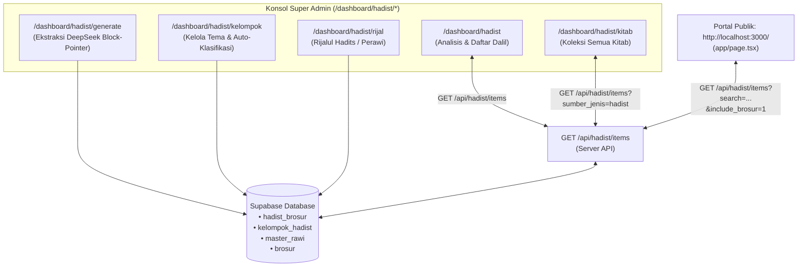

# Analisis Integrasi Pencarian Halaman Utama (`/`) dengan Data `/dashboard/hadist`

Dokumen ini menjawab pertanyaan apakah fitur pencarian di **`http://localhost:3000/`** bisa (dan sudah) merujuk pada data yang dikelola di **`http://localhost:3000/dashboard/hadist`**, bagaimana arsitektur alirannya, serta hal-hal penting yang perlu disempurnakan.

---

## 1. Jawaban Singkat: **BISA — dan Secara Data SUDAH Terhubung!**

Halaman publik **`/`** ([app/page.tsx](file:///Users/rifqiwariyanto/Documents/GitHub/NEXTJS/brosur-ahad-pagi/app/page.tsx#L209)) dan halaman konsol **`/dashboard/hadist`** ([app/dashboard/hadist/page.tsx](file:///Users/rifqiwariyanto/Documents/GitHub/NEXTJS/brosur-ahad-pagi/app/dashboard/hadist/page.tsx#L46)) **memanggil API dan tabel database yang sama persis**:

### Artinya:
- Setiap dalil Al-Qur'an & Hadits yang Anda **ekstrak** di `/dashboard/hadist/generate`, **kelompokkan temanya** di `/dashboard/hadist/kelompok`, atau **edit** di `/dashboard/hadist` **otomatis langsung bisa dicari di `http://localhost:3000/`** tanpa perlu sinkronisasi manual.
- **Catatan Role Keamanan:** Pengunjung publik di `/` **tidak diarahkan ke halaman `/dashboard/hadist`** (karena `/dashboard/*` diproteksi khusus role `superadmin`). Yang dirujuk oleh `/` adalah **sumber datanya** melalui API `/api/hadist/items` dan halaman baca publik `/bap/[tahun]/[slug]`.

---

## 2. Perbandingan Query yang Dipakai Sekarang

| Halaman | Endpoint yang Dipanggil | Parameter Aktif |
| :--- | :--- | :--- |
| **`/` (Publik)** | `GET /api/hadist/items` | `search=<query>&include_brosur=1` |
| **`/dashboard/hadist`** | `GET /api/hadist/items` | `search`, `sumber_jenis`, `rawi_kitab` |
| **`/dashboard/hadist/kitab`** | `GET /api/hadist/items` | `sumber_jenis=hadist` |
| **`/dashboard/hadist/kelompok`** | `GET /api/hadist/items` | `kelompok_id=<uuid>` |

### Urutan Hasil di Pencarian `/` Saat Ini
1. **Prioritas Utama (Atas):** Dalil dari tabel **`hadist_brosur`** (yang dikelola di `/dashboard/hadist/*`) — lengkap dengan teks Arab, terjemahan, sitasi takhrij (`perawi_sumber`, `rawi_kitab`, `juz`, `halaman`, `no_hadist`), label tema (`kelompok_hadist`), dan tombol buka brosur asal.
2. **Fallback (Bawah):** Potongan naskah dari tabel **`brosur`** (`include_brosur=1`, maks 30 brosur) jika ada brosur yang belum diekstrak ke `hadist_brosur` atau kata kunci muncul di luar kutipan dalil.

---

## 3. Rekomendasi Penyempurnaan Agar Pencarian `/` Makin Optimal

Karena seluruh fitur di `/dashboard/hadist/*` sudah rapi dan lengkap, ada **4 peningkatan ringan** yang sangat disarankan untuk halaman `/`:

### 1. Tampilkan Hanya Dalil `status_hadist=terverifikasi` di Portal Publik `/`
- **Kondisi sekarang:** `/` belum mengirim `status_hadist=terverifikasi`, sehingga dalil yang masih berstatus `mentah` (draft belum dicek) ikut muncul ke pengunjung umum.
- **Solusi:** Tambahkan `&status_hadist=terverifikasi` di [app/page.tsx](file:///Users/rifqiwariyanto/Documents/GitHub/NEXTJS/brosur-ahad-pagi/app/page.tsx#L209) (dan pastikan di `app/api/hadist/items/route.ts` fallback `include_brosur=1` tetap aktif meski `status_hadist=terverifikasi` dikirim).

### 2. Manfaatkan Filter `sumber_jenis`, `rawi_kitab`, dan `kelompok_id` di Halaman `/`
Endpoint `GET /api/hadist/items` **sudah siap mendukung** parameter berikut:
- `sumber_jenis=quran` | `hadist` (filter khusus Ayat Al-Qur'an atau Hadits saja).
- `rawi_kitab=Bukhari` | `Muslim` | dll (filter per kitab).
- `kelompok_id=<uuid>` (filter berdasarkan tema dari `/dashboard/hadist/kelompok`).
- `tahun=2025` atau `tahun_mulai` & `tahun_akhir`.

Di halaman `/`, cukup tambahkan *filter pills* ringkas di atas hasil pencarian (misal: `Semua` | `Al-Qur'an` | `Hadits` | `Brosur` + dropdown **Kitab** & **Tema**) tanpa perlu membuat API baru.

### 3. Tampilkan Badge Tema (`kelompok_hadist`) & Perawi (`rawi_teratas`) di Kartu Hasil `/`
Data `kelompok_hadist(nama_kelompok, warna_badge)` dan `rawi_teratas` sudah dikembalikan oleh `GET /api/hadist/items`. Menampilkan badge tema & nama sahabat perawi di kartu hasil `/` akan membuat data yang Anda rapikan di `/dashboard/hadist/kelompok` dan `/dashboard/hadist/rijal` langsung terasa manfaatnya oleh jamaah.

### 4. Amankan Method Write (`POST` / `PUT` / `DELETE`) pada API `/api/hadist/*`
- `GET /api/hadist/items`, `GET /api/hadist/kelompok`, `GET /api/hadist/rawi` tetap **publik (read-only)** agar halaman `/` bisa membacanya tanpa login.
- `POST`, `PUT`, dan `DELETE` pada `/api/hadist/items`, `/api/hadist/kelompok`, `/api/hadist/rawi`, dan `/api/hadist/generate-ai` sebaiknya diberi validasi sesi server (`resolveServerUserAccess`) agar **hanya `superadmin` / `admin`** yang bisa mengubah database.

---

## 4. Kesimpulan

| Pertanyaan | Jawaban |
| :--- | :--- |
| Apakah pencarian di `/` bisa merujuk data `/dashboard/hadist`? | **Ya, bisa dan sudah terhubung langsung** via `GET /api/hadist/items` (`hadist_brosur` + `kelompok_hadist` + `brosur`). |
| Apakah pengunjung `/` perlu login / akses `/dashboard/hadist`? | **Tidak.** `/` membaca data publik via API `GET`, sedangkan `/dashboard/hadist` tetap terkunci khusus `superadmin`. |
| Apa langkah terbaik berikutnya? | Tambahkan filter `status_hadist=terverifikasi`, filter chip (Al-Qur'an / Hadits / Kitab / Tema) di `/`, dan proteksi auth untuk method `POST/PUT/DELETE` di API `/api/hadist/*`. |
