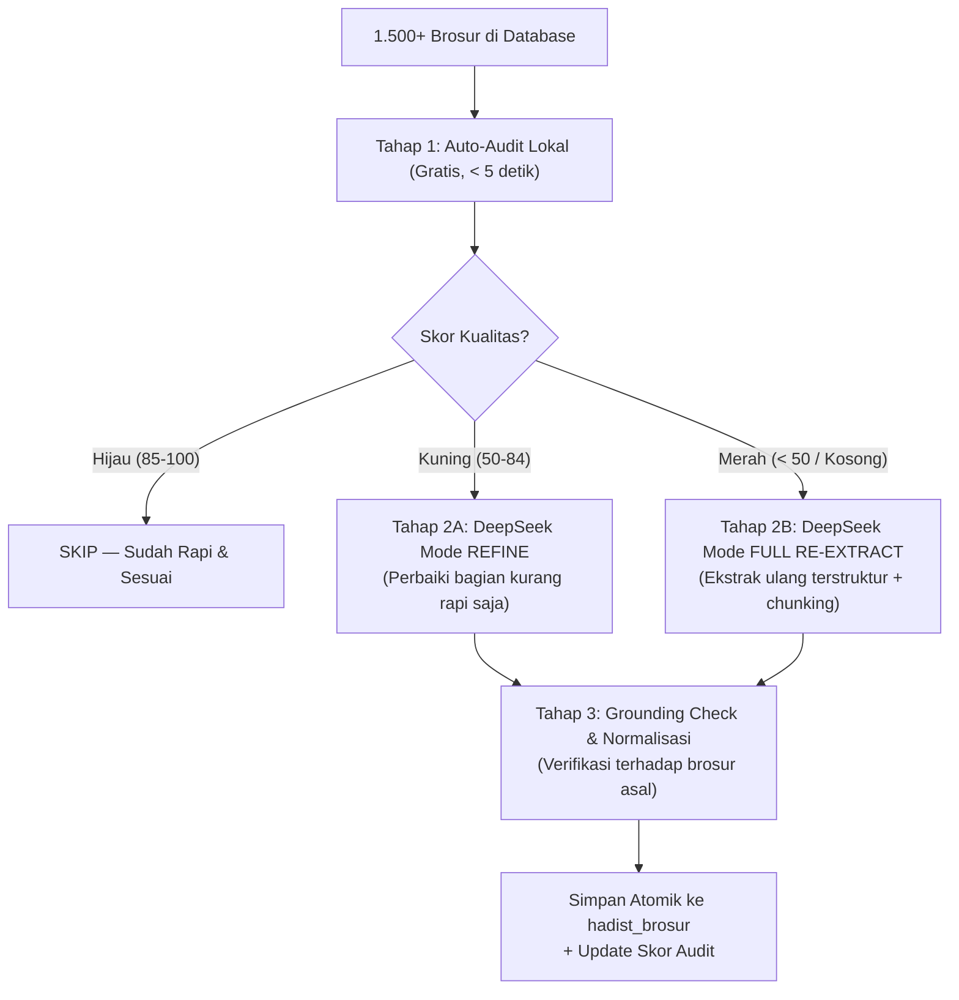

# Strategi Efektif Penyempurnaan Ekstraksi DeepSeek untuk 1.500+ Brosur

Dokumen ini merancang alur kerja (*pipeline*) agar **DeepSeek AI** mampu menyempurnakan hasil ekstraksi dalil (Al-Qur'an & Hadits) secara **rapi, akurat, dan persis sesuai brosur asal** untuk skala **~1.500 brosur**, tanpa membuang biaya API dan tanpa perlu mengecek manual satu per satu.

---

## 1. Kenapa Hasil Ekstraksi Saat Ini Bisa Kurang Rapi / Kurang Sesuai Brosur Asal?

Berdasarkan audit pada [app/api/hadist/generate-ai/route.ts](file:///Users/rifqiwariyanto/Documents/GitHub/NEXTJS/brosur-ahad-pagi/app/api/hadist/generate-ai/route.ts) dan skema tabel `brosur` & `hadist_brosur` di [supabase/init.sql](file:///Users/rifqiwariyanto/Documents/GitHub/NEXTJS/brosur-ahad-pagi/supabase/init.sql):

1. **Struktur Paragraf Hancur Sebelum Dikirim ke AI**
   - Fungsi `cleanBrosurTextForAI()` saat ini menghapus semua tag HTML dan mengganti seluruh whitespace termasuk baris baru (`\n`) dengan spasi tunggal (`.replace(/\s+/g, ' ')`).
   - Akibatnya, **Teks Arab, Terjemahan, Sitasi Takhrij (`[HR. Bukhari juz 1, hal. 80]`), dan Uraian/Penjelasan Ustadz** menyatu jadi 1 paragraf raksasa tanpa batas. AI jadi rawan mencampur uraian ke dalam `terjemahan` atau salah memasangkan takhrij.
2. **Pemotongan Teks di 24.000 Karakter**
   - Baris `cleanedText.slice(0, 24000)` memotong brosur panjang secara diam-diam sehingga dalil di bagian akhir brosur **tidak ikut terekstrak**.
3. **Belum Ada Audit Kesesuaian Otomatis**
   - Tidak ada deteksi otomatis mana brosur yang sudah rapi dan mana yang masih cacat (misalnya terjemahan terpotong `...` bekas Regex, rawi `"Sumber Tidak Dikenal"`, atau jumlah dalil di DB jauh lebih sedikit daripada jumlah blok Arab di brosur asal).
4. **Kolom Terstruktur Belum Dimanfaatkan Penuh**
   - Tabel `hadist_brosur` sudah punya kolom `sumber_jenis`, `nama_surat`, `no_ayat`, `rawi_kitab`, `juz`, `halaman`, `no_hadist`, `rawi_teratas`, `perawi_sumber`, tetapi sebagian belum diisi/dinormalisasi dengan standar baku.

---

## 2. Strategi 3-Tahap untuk 1.500 Brosur

Jangan langsung menembak ulang semua 1.500 brosur secara buta. Gunakan pendekatan **Audit Lokal → Eksekusi Selektif & Presisi → Verifikasi Otomatis**:



---

## 3. Tahap 1: Auto-Audit Kualitas Lokal (0 Rupiah, < 5 Detik)

Sebelum memanggil DeepSeek, jalankan fungsi audit lokal (TypeScript/SQL) pada 1.500 brosur untuk membandingkan `brosur.konten`/`teks_bersih` dengan baris `hadist_brosur` saat ini.

### Aturan Deteksi Masalah (*Audit Flags*)

| Kode Flag | Cara Deteksi Otomatis | Bobot Penalti |
| :--- | :--- | :---: |
| `NO_DATA` | Brosur punya teks Arab (≥ 30 char), tapi `hadist_brosur` = 0 baris | -100 |
| `MISSING_DALIL` | Jumlah blok Arab di brosur jauh lebih banyak dari jumlah dalil di DB (selisih ≥ 2) | -35 |
| `TRUNCATED_TEXT` | `terjemahan` diakhiri `...` (sisa Regex 600 char) atau panjang terjemahan < 20 char padahal Arab panjang | -25 |
| `UNKNOWN_RAWI` | `rawi_kitab` kosong atau berisi `"Sumber Tidak Dikenal"` | -20 |
| `MIXED_COMMENTARY` | `terjemahan` terlalu panjang (> 1.500 char) atau mengandung kalimat transisi uraian (*"Keterangan:", "Dari ayat di atas dapat dipahami..."*) | -20 |
| `MISMATCH_SOURCE` | Potongan teks Arab (tanpa harakat) atau 5 kata pertama terjemahan **tidak ditemukan** di `teks_bersih` brosur asal (indikasi salah kutip/halusinasi) | -40 |
| `MISSING_META` | Dalil Al-Qur'an tanpa `nama_surat`/`no_ayat`, atau hadits tanpa `perawi_sumber` | -10 |

### Manfaat Tahap 1
- Anda langsung tahu persis peta kondisi 1.500 brosur: berapa yang **Hijau** (aman di-skip), berapa **Kuning** (butuh *refine*), dan berapa **Merah** (butuh *re-extract* total).
- Menghemat biaya & waktu DeepSeek **30–60%** karena brosur yang sudah bagus tidak diproses ulang.

---

## 4. Tahap 2: Pipeline DeepSeek Presisi Tinggi

### 4.1. Pre-Processing yang Mempertahankan Struktur Brosur
Ubah pembersihan teks agar **mengambil dari `konten` (HTML asli) jika tersedia**, lalu ubah tag blok menjadi baris baru (`\n`), bukan spasi:

```ts
function prepareBrosurTextPreserveStructure(kontenOrText: string): string {
  return (kontenOrText || '')
    .replace(/<style[\s\S]*?<\/style>/gi, ' ')
    .replace(/<script[\s\S]*?<\/script>/gi, ' ')
    .replace(/<(br|\/p|\/div|\/tr|\/li|\/h[1-6])[^>]*>/gi, '\n')
    .replace(/<[^>]+>/g, ' ')
    .replace(/&nbsp;/gi, ' ')
    .replace(/&quot;/gi, '"')
    .replace(/&amp;/gi, '&')
    .replace(/[ \t]+/g, ' ')
    .replace(/\n{3,}/g, '\n\n')
    .trim();
}
```
Dengan pemisah `\n`, DeepSeek melihat struktur asli Brosur Ahad Pagi dengan sangat jelas:
```text
[Teks Arab Ayat/Hadits]
Artinya: "..." [HR. Bukhari juz 1, hal. 80]
Keterangan: ...
```

### 4.2. Chunking Aman untuk Brosur Panjang (> 18.000 Karakter)
- Jika panjang teks > 18.000 karakter, pecah berdasarkan batas `\n\n` (paragraf) menjadi beberapa chunk (masing-masing maks ~16.000 karakter) dengan *overlap* 1 paragraf terakhir agar dalil di perbatasan tidak terpotong.
- Gabungkan hasil JSON antar chunk lalu deduplikasi berdasarkan `stripArabicHarakat(kutipan_arab)` + prefix terjemahan.

### 4.3. Dua Mode Prompt DeepSeek

#### Mode A — **Full Re-Extract** (untuk Brosur Merah / Belum Diekstrak)
Aturan kunci yang wajib masuk ke `systemPrompt`:
1. **Verbatim / Persis Asal:** `kutipan_arab` dan `terjemahan` WAJIB disalin persis dari teks brosur asal. **DILARANG** meringkas, memotong, atau menambah kalimat sendiri.
2. **Pisahkan Terjemahan vs Uraian:** Kolom `terjemahan` hanya berisi arti ayat/hadits (biasanya diawali *"Artinya:"* atau tanda kutip). Penjelasan/komentar/uraian ustadz ditaruh di kolom `catatan` (maks 1–2 kalimat ringkas), **bukan** dicampur ke `terjemahan`.
3. **Urut Sesuai Brosur:** Kembalikan `items` sesuai urutan kemunculan di naskah brosur.
4. **Metadata Lengkap:** Ekstrak `sumber_jenis` (`quran` | `hadist`), `nama_surat`, `no_ayat` (jika Al-Qur'an), `rawi_kitab` (nama baku), `juz`, `halaman`, `no_hadist`, `rawi_teratas`, dan `perawi_sumber`.
5. **Gunakan `temperature: 0.0`** (bukan `0.1`) agar output se-deterministik mungkin dan tidak berimprovisasi.

#### Mode B — **Refine / Penyempurnaan** (untuk Brosur Kuning)
Kirim ke DeepSeek:
1. **Naskah Brosur Asal** (berstruktur `\n`).
2. **Data Ekstraksi Saat Ini** (JSON dari `hadist_brosur`).
3. **Daftar Masalah dari Auto-Audit** (misalnya: *"Item #2 terjemahan terpotong `...`; Item #4 rawi belum terdeteksi; ada 1 blok Arab di paragraf akhir yang belum masuk"*).

Instruksi ke DeepSeek:
> *"Bandingkan data ekstraksi saat ini dengan naskah brosur asal. Perbaiki HANYA bagian yang terpotong, salah rawi, tercampur uraian, atau terlewat, sehingga 100% sesuai dengan naskah brosur asal. Kembalikan daftar lengkap yang sudah disempurnakan."*

---

## 5. Tahap 3: Post-Processing & Grounding Check Otomatis

Sebelum hasil DeepSeek disimpan ke `hadist_brosur`, jalankan 3 lapisan validasi di server:

1. **Grounding Verification (Cek Kesesuaian dengan Brosur Asal)**
   - Normalisasi teks brosur asal (hapus harakat Arab & tanda baca).
   - Untuk setiap item output DeepSeek:
     - Ambil 20–40 karakter inti dari `kutipan_arab` (tanpa harakat) → cek apakah muncul di teks brosur asal.
     - Ambil 30 karakter inti dari `terjemahan` → cek apakah muncul di teks brosur asal.
   - Jika tidak cocok sama sekali → tandai `status_hadist = 'mentah'` dan catat flag `NEED_MANUAL_REVIEW` agar tidak mencemari data terverifikasi.
2. **Normalisasi Kamus `rawi_kitab`**
   - Petakan variasi penulisan ke nama standar agar filter & statistik rapi:
     - `HR. Bukhari`, `Imam Bukhari`, `Al-Bukhari`, `Shahih Bukhari` → **`Bukhari`**
     - `HR. Muslim`, `Shahih Muslim` → **`Muslim`**
     - `Abu Daud`, `Abu Dawud` → **`Abu Dawud`**
     - `Nasa'i`, `An-Nasa'i`, `Nasai` → **`An-Nasa'i`**
     - `QS.`, `Al-Quran`, `Qur'an` → **`Al-Qur'an`**
3. **Simpan Aman (Insert-Then-Delete / Transaksi)**
   - Insert data hasil penyempurnaan terlebih dahulu, baru hapus ID lama setelah insert sukses.
   - Jangan mengisi kolom `kutipan_arab_gundul` secara manual jika di Postgres sudah `GENERATED ALWAYS AS (strip_harakat(kutipan_arab)) STORED`.

---

## 6. Strategi Eksekusi 1.500 Brosur (Biar Cepat, Aman, & Murah)

### Estimasi Biaya & Waktu dengan `deepseek-chat` (V3)
- Rata-rata 1 brosur: ~3.500 token input + ~1.500 token output.
- Total 1.500 brosur (skenario terburuk jika 100% diproses ulang):
  - Input: ~5,25 juta token (dengan *Context Cache Hit* untuk system prompt).
  - Output: ~2,25 juta token.
  - **Estimasi biaya total:** sekitar **\$2 – \$4 (Rp 30.000 – Rp 65.000)** untuk seluruh 1.500 brosur!
  - *(Jika lewat tahap Auto-Audit dan hanya 60–70% yang perlu diproses ulang, biaya makin hemat sekitar **Rp 20.000 – Rp 45.000**).*
- **Estimasi waktu (Background Queue, 4–5 paralel):** **~1 – 1,5 jam** untuk 1.500 brosur (bisa ditinggal / tutup browser).

### Alur Eksekusi Bertahap yang Disarankan (Jangan Langsung 1.500 Sekaligus!)

1. **Step 1 — Pilot Test (20 Brosur Sampel)**
   - Ambil 20 brosur beragam: 5 brosur tahun lama (1995–2005, biasanya format CHM lama), 5 brosur panjang (> 20.000 karakter), 5 brosur bermasalah (flag Merah), 5 brosur normal.
   - Jalankan ekstraksi/refine lalu periksa hasilnya secara visual.
   - Jika ada pola salah yang berulang (misal format sitasi khas MTA seperti `QS. Al-Baqarah : 183` atau `HR. Ahmad juz 2, hal. 145`), sempurnakan prompt-nya dulu di tahap ini.
2. **Step 2 — Jalankan Auto-Audit 1.500 Brosur**
   - Dapatkan laporan pembagian: Hijau / Kuning / Merah.
3. **Step 3 — Eksekusi Massal di Background per Prioritas**
   - Jalankan **Kelompok Merah** dulu (paling berdampak pada kualitas pencarian).
   - Lanjut ke **Kelompok Kuning** (mode *Refine*).
   - Gunakan **Background Worker (concurrency 4–5 + auto-retry 3×)** agar aman ditinggal.
4. **Step 4 — Audit Ulang & Review Manual Khusus Anomali**
   - Jalankan Auto-Audit lagi setelah selesai.
   - Biasanya 95%+ brosur sudah naik ke **Hijau**. Sisa 3–5% (~50 brosur dengan flag `NEED_MANUAL_REVIEW`) cukup diperiksa manual lewat tampilan *side-by-side* di dashboard.

---

## 7. Tambahan Fitur UI di `/dashboard/hadist/generate`

Agar admin mudah memantau & menyempurnakan brosur satu per satu maupun massal:

1. **Badge Skor Kualitas di Daftar Brosur Kiri:**
   - Hijau (`95% Rapi`), Kuning (`65% Perlu Refine`), Merah (`0% Belum / Bermasalah`).
   - Filter cepat: `Semua` | `Bermasalah / Belum` | `Perlu Refine` | `Sudah Rapi`.
2. **Tombol "Audit Kualitas Semua Brosur" (Gratis & Instan):**
   - Menghitung ulang skor kualitas seluruh brosur yang sedang difilter tanpa memanggil AI.
3. **Tombol "Sempurnakan dengan DeepSeek (Refine)" & Modal Bandingkan Asal vs Hasil:**
   - Menampilkan **Naskah Brosur Asal** di sisi kiri dan **Daftar Dalil Hasil Ekstraksi** di sisi kanan agar admin bisa verifikasi dalam hitungan detik.

---

## 8. Roadmap Implementasi

1. **Fase 1 (Kualitas Ekstraksi):** Upgrade [app/api/hadist/generate-ai/route.ts](file:///Users/rifqiwariyanto/Documents/GitHub/NEXTJS/brosur-ahad-pagi/app/api/hadist/generate-ai/route.ts) → preserve paragraf `\n` dari `konten`, chunking > 18.000 char, `temperature: 0`, mode `refine`, normalisasi `rawi_kitab`, dan *grounding check*.
2. **Fase 2 (Auto-Audit):** Tambah endpoint `POST /api/hadist/audit` untuk menilai kualitas 1.500 brosur secara lokal dan menyimpan skor + flag masalah.
3. **Fase 3 (Background Queue 1.500 Brosur):** Terapkan tabel antrean Postgres + Worker/Cron (mengacu pada [ANALISIS_GENERATOR_HADIST_BACKGROUND.md](file:///Users/rifqiwariyanto/Documents/GitHub/NEXTJS/brosur-ahad-pagi/md/ANALISIS_GENERATOR_HADIST_BACKGROUND.md)) agar 1.500 brosur bisa diproses otomatis di belakang layar.
4. **Fase 4 (UI Audit & Refine):** Tambah filter skor kualitas, tombol **Audit**, tombol **Sempurnakan (Refine)**, dan panel bandingkan teks asal di `/dashboard/hadist/generate`.
