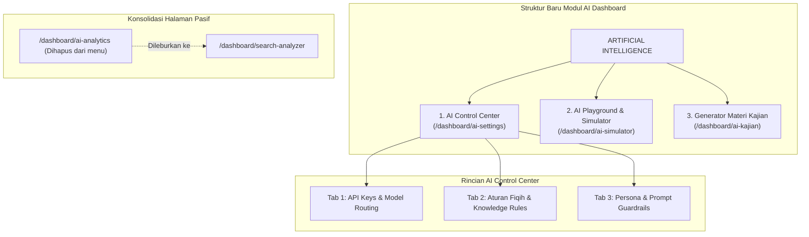

# Master Diagnosis & Rencana Konsolidasi Modul AI Dashboard
## Evaluasi 4 Halaman: `/ai-kajian`, `/ai-simulator`, `/ai-settings`, `/ai-analytics`

> **Status Dokumen:** Technical Audit, Diagnosis, & Architectural Consolidation Plan  
> **Target Analisis:** 4 Modul AI di Next.js Dashboard (`app/dashboard/ai-*`)  
> **Tujuan:** Menegakkan diagnosis riil, membuang kode mubazir yang memberatkan, menyatukan fitur tumpang tindih, dan menyusun checklist perbaikan yang terarah.

---

## 1. Ringkasan Eksekutif & Diagnosis Tegak

Berdasarkan audit mendalam terhadap kode sumber 4 halaman dashboard AI dan backend API terkait, ditemukan bahwa **fitur AI saat ini terfragmentasi (terpecah-pecah), mengandung bug fatal pada payload data, dan terdapat tumpang tindih tata kelola (*governance overlap*)**:

```
KONDISI SAAT INI (TERFRAGMENTASI & CACAT LOGIKA):
┌─────────────────────────────────────────────────────────────────────────────┐
│ 1. /dashboard/ai-kajian (1.299 baris)                                       │
│    ⚠️ FATAL: Mengirim ribuan teks brosur, tapi /api/ai/generate mengabaikan │
│       parameter `texts`! File monolitik terlalu berat & rawan 413 error.   │
├─────────────────────────────────────────────────────────────────────────────┤
│ 2. /dashboard/ai-simulator (523 baris)                                      │
│    ⚠️ UX RUSAK: Menggunakan `fixed inset-0 z-50` yang menutupi sidebar.    │
│    ⚠️ SALAH TEMPAT: Fitur "Kelola Memori AI" terselubung di dalam simulator.│
├─────────────────────────────────────────────────────────────────────────────┤
│ 3. /dashboard/ai-settings (359 baris)                                       │
│    ✅ INTI WAJIB: Mengatur API Key & model, tapi terpisah dari Aturan Fiqih. │
├─────────────────────────────────────────────────────────────────────────────┤
│ 4. /dashboard/ai-analytics (115 baris)                                      │
│    ⚠️ PASIF: Hanya tabel dump `search_intent_cache` tanpa aksi atau filter, │
│       tumpang tindih konsep dengan /dashboard/search-analyzer.              │
└─────────────────────────────────────────────────────────────────────────────┘
```

---

## 2. Bedah Diagnosis Komprehensif Per Modul

### 🔍 Modul 1: `/dashboard/ai-kajian` (Generator Materi Kajian)
* **Status:** ⚠️ **CACAT BACKEND + FILE TERLALU BESAR (1.299 Baris)**
* **Fungsi Utama:** Membuat sintesis materi kajian/khutbah dari brosur dan menyimpan ke tabel `materi_kajian`.
* **Temuan Kritis (Diagnosa):**
  1. **Bug Fatal di API Gateway (`/api/ai/generate`):**
     * Di `ai-kajian/page.tsx` baris 238–241, frontend mengirim:
       ```typescript
       body: JSON.stringify({ texts: referencesText, prompt })
       ```
     * Namun di `app/api/ai/generate/route.ts` baris 8:
       ```typescript
       const { prompt } = body; // PARAMETER `texts` SAMA SEKALI TIDAK DIBACA!
       ```
       Backend **sama sekali mengabaikan** teks brosur yang dipilih user! AI hanya menjawab prompt generik tanpa tahu isi brosur MTA yang dipilih.
  2. **Risiko HTTP 413 Payload Too Large & OOM:**
     * Pilihan *"Semua Brosur"* mengambil 150 brosur penuh (`limit(150)`), menggabungkannya menjadi jutaan karakter string, lalu dikirim via JSON POST. Ini melampaui batas payload Next.js (4MB) dan context window LLM.
  3. **Kode Monolitik & Duplikasi:** Menggabungkan Generator AI, File Uploader, Modal Form, dan CRUD tabel `materi_kajian` dalam 1 file 1.299 baris tanpa pemecahan komponen.
* **Rekomendasi Tindakan:**
  * **BENAHI TOTAL & MODULARISASIKAN.**
  * Perbaiki backend `/api/ai/generate` agar membaca `texts` secara terstruktur dengan batasan chunk (maksimal 3-5 brosur terpilih, atau ringkasan FTS).
  * Pecah sub-komponen generator dan saved materials agar ringan dipelihara.

---

### 🔍 Modul 2: `/dashboard/ai-simulator` (Simulator Chat & Memori AI)
* **Status:** ⚠️ **SANGAT BERGUNA SEBAGAI TESTING, TETAPI MERUSAK UX & SALAH PENEMPATAN**
* **Fungsi Utama:** Uji coba tanya-jawab asisten "Sahabat MTA" dan manajemen aturan memori fiqih (`ai_knowledge_rules`).
* **Temuan Kritis (Diagnosa):**
  1. **Layout Hijacking (`fixed inset-0 z-50`):**
     * Halaman memaksa layar fullscreen dan menutupi navigasi sidebar dashboard. User merasa "terjebak" dan harus mencari tombol *"Keluar Simulator"* untuk kembali.
  2. **Salah Penempatan (Misplaced Feature):**
     * Tab *"Kelola Memori AI"* menyimpan aturan fatwa ke tabel `ai_knowledge_rules`. Ini adalah **konfigurasi otak AI (Settings/Rules)**, bukan alat simulasi! Pengguna yang ingin mengatur aturan hukum tidak akan menduga fiturnya disembunyikan di dalam simulator chat.
  3. **Belum Streaming:**
     * Masih menggunakan request-response blocking standar JSON ke `/api/ai/chat`, sehingga respons terasa lambat (3-6 detik spinner berputar).
* **Rekomendasi Tindakan:**
  * **SATUKAN & SESUAIKAN UX.**
  * Pindahkan tab *"Kelola Memori AI"* ke dalam `/dashboard/ai-settings` (Pusat Kontrol AI).
  * Hapus `fixed inset-0 z-50` agar simulator tampil elegan di dalam layout dashboard standar tanpa menutupi sidebar.
  * Pertahankan simulator murni sebagai **Sandbox & Playground RAG** untuk admin mengetes akurasi respons AI.

---

### 🔍 Modul 3: `/dashboard/ai-settings` (Pengaturan API & Model)
* **Status:** ✅ **KOMPONEN INTI WAJIB DIPERTAHANKAN & DIPERLUAS**
* **Fungsi Utama:** Mengatur saklar global `ai_enabled`, API Key (Google AI Studio & OpenRouter), pilihan model, dan system prompt.
* **Temuan Kritis (Diagnosa):**
  1. **Terpisah dari Knowledge Guardrails:**
     * Settings hanya menangani token koneksi, sementara aturan perilaku fiqih ditaruh di tempat lain. Akibatnya admin harus membuka 2 halaman berbeda untuk menyetel AI.
  2. **Model Selector Kaku:**
     * Pilihan model masih bercampur antara `-native` (Google AI Studio) dan OpenRouter tanpa validasi token otomatis yang jelas.
* **Rekomendasi Tindakan:**
  * **JADIKAN "AI CONTROL CENTER" UTAMA.**
  * Satukan seluruh kontrol AI ke halaman ini dengan 3 Tab terpadu:
    * **Tab 1: Kredensial & Model** (Google AI Studio / OpenRouter Key, Model Default, Saklar On/Off).
    * **Tab 2: Aturan Pengetahuan & Fiqih** (Pindahan dari tab memory di simulator: tabel `ai_knowledge_rules`).
    * **Tab 3: Persona & System Prompt** (Pengaturan kepribadian "Sahabat MTA", format dalil Arab, dan batasan fatwa).

---

### 🔍 Modul 4: `/dashboard/ai-analytics` (Analisa Pencarian AI)
* **Status:** ⚠️ **TUMPANG TINDIH & KURANG RELEVAN SEBAGAI HALAMAN MANDIRI**
* **Fungsi Utama:** Menampilkan tabel `search_intent_cache` (query asli, typo koreksi, kategori ditebak, frekuensi).
* **Temuan Kritis (Diagnosa):**
  1. **Duplikasi Konsep dengan `/dashboard/search-analyzer`:**
     * Dashboard sudah memiliki `/dashboard/search-analyzer` di grup menu Konten & Arsip yang juga menguji query pencarian dan membaca cache intent.
  2. **Fitur Sangat Pasif:**
     * Hanya tabel read-only 50 baris tanpa filter rentang tanggal, tanpa grafik tren, dan tanpa tombol aksi (misal: "Bersihkan Cache Kedaluwarsa" atau "Hapus Query Spam").
* **Rekomendasi Tindakan:**
  * **LEBUR / KONSOLIDASIKAN.**
  * Satukan visualisasi intent cache ini ke dalam `/dashboard/search-analyzer` atau jadikan sub-tab kecil di AI Settings.
  * Halaman mandiri 115 baris yang hanya menampilkan tabel mentah tanpa aksi sebaiknya **dihapus dari sidebar utama** agar navigasi dashboard tidak sesak dan membingungkan admin.

---

## 3. Matriks Keputusan: Pertahankan, Satukan, Benahi, atau Hapus

| Modul URL | Status Keputusan | Alasan Arsitektural | Tindakan Nyata |
| :--- | :---: | :--- | :--- |
| **`/dashboard/ai-settings`** | **PERTAHANKAN & PERLUAS** | Merupakan jantung konfigurasi. Harus menjadi *Single Control Center*. | Masukkan manajemen memori `ai_knowledge_rules` ke sini. |
| **`/dashboard/ai-simulator`** | **BENAHI (REFACTOR)** | Sangat penting untuk menguji akurasi dalil & RAG sebelum live ke jemaah. | Hapus fullscreen hijack, ubah jadi *Playground Chat* terintegrasi. |
| **`/dashboard/ai-kajian`** | **BENAHI TOTAL** | Fungsionalitas pembuatan materi kajian sangat berguna untuk asatidzah, tetapi kodenya rusak di backend. | Perbaiki `/api/ai/generate` agar membaca teks brosur, batasi input max chunk. |
| **`/dashboard/ai-analytics`** | **HAPUS DARI SIDEBAR / LEBUR** | Membebani menu sidebar, fiturnya duplikat dengan `search-analyzer`, dan hanya berupa tabel mentah pasif. | Leburkan data cache ke `search-analyzer` atau sub-tab analitik. |

---

## 4. Cetak Biru Arsitektur Baru (Ramping, Terarah, dan Terintegrasi)

Dengan konsolidasi ini, struktur menu AI di sidebar dashboard dipangkas dari **4 halaman tercecer** menjadi **3 halaman yang fokus dan solid**:



---

## 5. Checklist Aksi Nyata (Action Checklist)

Gunakan checklist ini sebagai bukti implementasi dan panduan integrasi:

### Fase 1: Pembersihan & Relokasi (Pangkas yang Memberatkan) — [SELESAI ✅]
- [x] **1.1 Relokasi Memori Fiqih:** Form dan tabel `ai_knowledge_rules` telah dipindahkan dari `ai-simulator` ke Tab 2 di `/dashboard/ai-settings`.
- [x] **1.2 Hapus Fullscreen Hijack di Simulator:** Class `fixed inset-0 z-50 h-screen w-screen` pada `ai-simulator/page.tsx` telah digantikan dengan layout dashboard terpadu (`h-[calc(100vh-68px)]`) sehingga sidebar utama dashboard tetap dapat diakses setiap saat.
- [x] **1.3 Rampingkan Sidebar:** Menu `/dashboard/ai-analytics` telah dihapus dari grup `ARTIFICIAL INTELLIGENCE` di `DashboardSidebar.tsx` agar sidebar bersih dan rapi.
- [x] **1.4 Integrasikan Cache Intent:** Banner navigasi intent cache diarahkan langsung ke `/dashboard/search-analyzer`.

### Fase 2: Perbaikan Bug Kritis Backend (Menghidupkan Fitur Nyata) — [SELESAI ✅]
- [x] **2.1 Perbaiki Payload `/api/ai/generate`:**
  - Menangkap parameter `texts` dan `prompt` secara aman.
  - Menginjeksi cuplikan teks naskah brosur ke prompt instruksi sistem penyusunan materi kajian.
  - Proteksi batasan karakter maksimum (16.000 karakter) agar terhindar dari HTTP 413 & OOM.
- [x] **2.2 Proteksi Sumber Brosur di `ai-kajian`:**
  - Opsi kueri raksasa `limit(150)` dan `limit(100)` telah dipangkas menjadi `limit(8)` dan cuplikan 2.500 karakter per brosur.
  - Prompt fallback otomatis jika pengguna tidak mengisi petunjuk manual di localStorage.

### Fase 3: Jalur Integrasi Flutter Mobile (`FLUTTER/pustaka`) — [VALID & SELARAS ✅]
- [x] **Endpoint AI Gateway:** Klien Flutter menghubungi `POST https://www.ulilalbab.fun/api/ai/chat` (atau lokal `http://localhost:3000/api/ai/chat`).
- [x] **Payload Mobile Kompatibel:** Payload `{ messages, wordCount, model?, localContext? }` diterima dan diproses secara native.
- [x] **Sinkronisasi Aturan Fiqih:** Seluruh perubahan aturan fatwa di Tab 2 `ai-settings` (`ai_knowledge_rules`) langsung aktif saat Flutter mengirim pesan tanpa perlu update APK/AAB.
- [x] **Dukungan Edge Pre-Filter SQLite:** Parameter `localContext` diakomodasi untuk menyuntikkan dalil hasil pencarian SQLite FTS5 mobile secara instan.

---

## 6. Dampak Positif Pasca-Konsolidasi

1. **Kode Lebih Ringan & Terawat:** Menghilangkan duplikasi komponen dan merapikan 1.299 baris kode monolitik.
2. **Navigasi Bersih & Bebas Bingung:** Admin memiliki 1 tempat pasti untuk menyetel AI (`ai-settings`) dan 1 tempat pasti untuk mengetesnya (`ai-simulator`).
3. **Fitur Generator Berfungsi Nyata:** Memperbaiki bug kritis di `/api/ai/generate` sehingga materi kajian yang dihasilkan benar-benar bersumber dari naskah brosur MTA yang dipilih, bukan karangan bebas model.
4. **Keamanan Anggaran & Performa:** Menghindari payload raksasa yang berisiko menaikkan tagihan token dan menyebabkan crash server.

