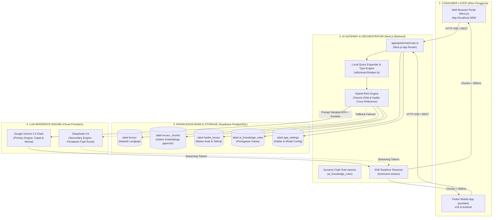
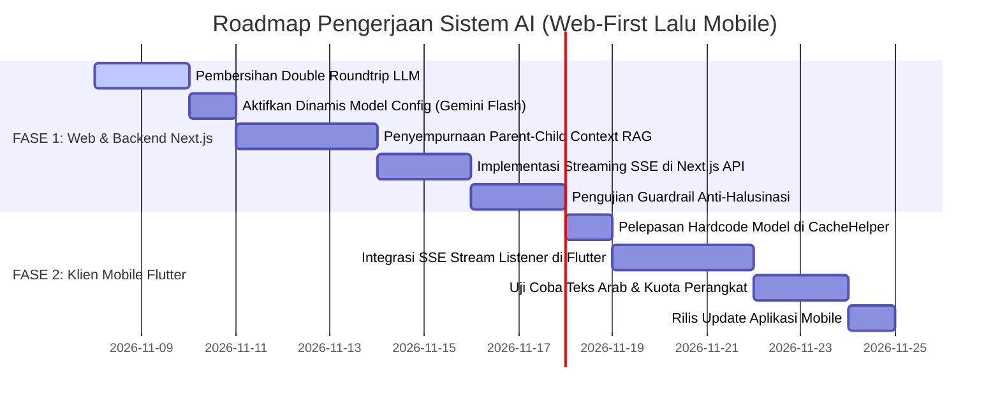

# Master Dokumen Arsitektur & Roadmap Sistem AI Pustaka MTA
## Pendekatan Terpadu: Web Engine (Next.js) Terlebih Dahulu, Disusul Klien Mobile (Flutter)

> **Status Dokumen:** Master Blueprint & Single Source of Truth  
> **Tanggal Rilis:** November 2026  
> **Versi:** 2.0 (Fokus Web-First, Streaming SSE & Hybrid Parent-Child RAG)  
> **Repositori Target:**
> 1. Web & Backend AI Engine: [`NEXTJS/brosur-ahad-pagi`](file:///Users/rifqiwariyanto/Documents/GitHub/NEXTJS/brosur-ahad-pagi)
> 2. Klien Mobile: [`FLUTTER/pustaka`](file:///Users/rifqiwariyanto/Documents/GitHub/FLUTTER/pustaka)

---

## Daftar Isi
1. [Eksekutif Summary & Visi Sistem AI Pustaka MTA](#1-eksekutif-summary--visi-sistem-ai-pustaka-mta)
2. [Arsitektur Sistem Terpadu (Next.js Gateway & Flutter Consumer)](#2-arsitektur-sistem-terpadu-nextjs-gateway--flutter-consumer)
3. [Audit Kritis & Analisis Masalah Aktual (Current Bottlenecks)](#3-audit-kritis--analisis-masalah-aktual-current-bottlenecks)
4. [Komparasi Model AI & Analisis Biaya Operasional Riil](#4-komparasi-model-ai--analisis-biaya-operasional-riil)
5. [FASE 1: FOKUS PENINGKATAN WEB & BACKEND ENGINE (NEXT.JS)](#5-fase-1-fokus-peningkatan-web--backend-engine-nextjs)
   - [5.1 Memangkas Double Roundtrip (Pangkas Latensi 50%)](#51-memangkas-double-roundtrip-pangkas-latensi-50)
   - [5.2 Desentralisasi Pemilihan Model (Server-Driven Config)](#52-desentralisasi-pemilihan-model-server-driven-config)
   - [5.3 Perbaikan Context Window & Cross-Reference Dalil Hadits](#53-perbaikan-context-window--cross-reference-dalil-hadits)
   - [5.4 Mengaktifkan Hybrid RAG (pgvector + FTS5 di Supabase)](#54-mengaktifkan-hybrid-rag-pgvector--fts5-di-supabase)
   - [5.5 Implementasi Streaming SSE (Server-Sent Events)](#55-implementasi-streaming-sse-server-sent-events)
   - [5.6 Guardrails Fiqih "Sahabat MTA" & Rule Engine Dinamis](#56-guardrails-fiqih-sahabat-mta--rule-engine-dinamis)
6. [FASE 2: FOKUS KLIEN MOBILE & OFFLINE INTELLIGENCE (FLUTTER)](#6-fase-2-fokus-klien-mobile--offline-intelligence-flutter)
   - [6.1 Konsumsi Stream SSE & Efek Typewriter Instan](#61-konsumsi-stream-sse--efek-typewriter-instan)
   - [6.2 Penyesuaian Payload & Pelepasan Hardcode Model](#62-penyesuaian-payload--pelepasan-hardcode-model)
   - [6.3 Tipografi Matan Arab & Render Markdown Plus](#63-tipografi-matan-arab--render-markdown-plus)
   - [6.4 Kuota Harian Perangkat & Sesi Offline di Perangkat](#64-kuota-harian-perangkat--sesi-offline-di-perangkat)
   - [6.5 Migrasi Database Lokal: Dari Hive ke SQLite FTS5 (Pre-Filtering & Hemat Token 75%)](#65-migrasi-database-lokal-dari-hive-ke-sqlite-fts5-pre-filtering--hemat-token-75)
7. [Roadmap Pelaksanaan Bertahap & Checklist Kesiapan Produksi](#7-roadmap-pelaksanaan-bertahap--checklist-kesiapan-produksi)
8. [Spesifikasi Environment Server (`.env.local`)](#8-spesifikasi-environment-server-envlocal)

---

## 1. Eksekutif Summary & Visi Sistem AI Pustaka MTA

Sistem **AI Pustaka MTA** (bernama asisten *"Sahabat MTA"*) dirancang untuk menjadi rujukan digital cerdas bagi jemaah, asatidzah, dan masyarakat umum dalam menelusuri fatwa, kajian tematik, serta dalil hukum Islam yang bersumber murni dari kurikulum **Brosur Ahad Pagi Majlis Tafsir Al-Qur'an (MTA)** sejak tahun 1995 hingga edisi terbaru.

### Prinsip Utama Sistem:
1. **Prinsip Anti-Halusinasi & Anti-Inferensi (Strict Grounding):** AI dilarang keras mengarang materi brosur, beranalogi tanpa dalil, atau mengutip sumber di luar korpus resmi Brosur MTA dan hadits shahih yang telah diverifikasi.
2. **Strategi Pengembangan: Web-First, Kemudian Mobile:**
   - **Langkah 1 (Web Next.js):** Sempurnakan dahulu otak AI, pipeline RAG, kecepatan respons (streaming), dan akurasi dalil di backend Next.js.
   - **Langkah 2 (Mobile Flutter):** Hubungkan klien mobile ke API yang sudah stabil, cepat, dan teruji tanpa perlu bolak-balik mengubah arsitektur server.
3. **Efisiensi Anggaran Berkelanjutan:** Menghasilkan biaya per tanya-jawab di bawah **Rp 5,-** menggunakan kombinasi model mutakhir (Google Gemini 2.5 Flash & DeepSeek-V3).

---

## 2. Arsitektur Sistem Terpadu (Next.js Gateway & Flutter Consumer)



---

## 3. Audit Kritis & Analisis Masalah Aktual (Current Bottlenecks)

Berdasarkan investigasi mendalam terhadap kode sumber di Next.js dan Flutter, ditemukan **5 titik kelemahan utama** yang menyebabkan sistem sebelumnya lambat (4–8 detik) dan berisiko salah konteks:

```
┌─────────────────────────────────────────────────────────────────────────────┐
│                    ALUR LAMA (LAMBAT & RAWAN SALAH):                        │
│ User Tanya ──► [LLM 1: Ekstrak Kata Kunci] (2-3 dtk)                        │
│                     │                                                       │
│                     ▼                                                       │
│             [FTS Supabase] ──► Potong Kaku 0 s/d 4.000 karakter             │
│                     │           (Sering terpotong di mukadimah brosur)      │
│                     ▼                                                       │
│                [LLM 2: Generate Jawaban] (2-4 dtk)                          │
│                     │                                                       │
│                     ▼                                                       │
│           Response JSON Utuh (Total Tunggu: 4-8 Detik)                      │
└─────────────────────────────────────────────────────────────────────────────┘

┌─────────────────────────────────────────────────────────────────────────────┐
│                    ALUR BARU (CEPAT, TEPAT, & HEMAT):                       │
│ User Tanya ──► [Local Tokenizer & Typo Fix] (1-3 ms, Rp 0,-)                │
│                     │                                                       │
│                     ▼                                                       │
│             [Hybrid RAG: Vector + Parent-Child Block] (150 ms)              │
│                     │  (Mendapat 1 halaman penuh yang memuat dalil inti)    │
│                     ▼                                                       │
│             [Single LLM Call: Gemini 2.5 Flash + SSE Stream] (< 800 ms)     │
│                     │                                                       │
│                     ▼                                                       │
│           Karakter Pertama Muncul di Layar dalam Waktu < 1 Detik!           │
└─────────────────────────────────────────────────────────────────────────────┘
```

### Rincian Temuan Masalah:
1. **Double LLM Roundtrip di Next.js (`route.ts`):** Server memanggil LLM dua kali berturut-turut (panggilan 1 untuk ekstraksi keyword, panggilan 2 untuk jawaban). Latensi menjadi ganda dan token terbuang sia-sia.
2. **Klien Mobile Mengirim Model Hardcode:** Di Flutter `CacheHelper.getChatModel()` selalu mengirim `'openai/gpt-4o-mini'`, sehingga server mengabaikan pengaturan dinamis `google/gemini-2.5-flash` di Supabase. Biaya output menjadi 2x lebih mahal.
3. **Pemotongan Konteks Kaku (`indexOf(firstWord)`):** Jika keyword jamak tidak ditemukan di awal teks, server memotong dari karakter `0 s/d 4000`. Bagian ini biasanya hanya salam/mukadimah, sedangkan matan hadits dan hukum ada di bagian tengah/akhir brosur. AI pun salah mengira materi tidak ada di brosur.
4. **Modul Vektor Embedding Masih Tidur:** Modul `generate-chunks` sudah membuat tabel `brosur_chunks`, namun endpoint chat belum pernah memanfaatkannya.
5. **Koneksi Non-Streaming (Blocking):** Klien menunggu seluruh kalimat selesai dirangkai di server, membuat layar terasa membeku (*freeze*) selama beberapa detik.

---

## 4. Komparasi Model AI & Analisis Biaya Operasional Riil

Daftar harga pasar per 1 juta token (Q4 2025 / 2026):

| Nama Model | Provider Host | Harga Input / 1M | Harga Output / 1M | Context Window | Waktu Respons (TTFT) | Kualitas Dalil & Fiqih | Rekomendasi Peran |
| :--- | :--- | :--- | :--- | :--- | :--- | :--- | :--- |
| **Google Gemini 2.5 Flash** | Vertex / OpenRouter | **\$0.075** (~Rp 1.200) | **\$0.30** (~Rp 4.800) | 1.000.000 token | ⚡⚡⚡⚡⚡ (< 0.8 dtk) | ⭐⭐⭐⭐⭐ Sangat Rapi | **Engine Utama (Default)** |
| **DeepSeek-V3** | DeepSeek / OpenRouter | **\$0.14** (~Rp 2.240) | **\$0.28** (~Rp 4.480) | 64.000 token | ⚡⚡⚡⚡ (~ 1.3 dtk) | ⭐⭐⭐⭐⭐ Penalaran Tajam | **Failover / Kasus Rumit** |
| **Qwen 2.5 72B Instruct** | Alibaba / OpenRouter | **\$0.35** (~Rp 5.600) | **\$0.40** (~Rp 6.400) | 128.000 token | ⚡⚡⚡ (~ 1.9 dtk) | ⭐⭐⭐⭐⭐ Sastra Hadits | Alternatif Khusus Arab |
| **GPT-4o-mini** | OpenAI / OpenRouter | **\$0.15** (~Rp 2.400) | **\$0.60** (~Rp 9.600) | 128.000 token | ⚡⚡⚡⚡ (~ 1.4 dtk) | ⭐⭐⭐⭐ Baik | Standar (Lebih Mahal 2x) |

### Simulasi Biaya Riil Bulanan (Asumsi Input 2.500 Token, Output 400 Token):
- **Skala 10.000 Pertanyaan/Bulan (Fase Pilot / Internal Asatidzah):**
  - **Gemini 2.5 Flash:** \$1.88 (input) + \$1.20 (output) = **\$3.08 (~Rp 49.000,- / bulan)**.
  - **DeepSeek-V3:** \$3.50 + \$1.12 = **\$4.62 (~Rp 74.000,- / bulan)**.
  - **GPT-4o-mini:** \$3.75 + \$2.40 = **\$6.15 (~Rp 98.000,- / bulan)**.
- **Skala 100.000 Pertanyaan/Bulan (Nasional Jemaah Seluruh Indonesia):**
  - **Gemini 2.5 Flash:** **\$30.80 (~Rp 492.000,- / bulan)** $\to$ **Hanya Rp 4,92 per pertanyaan!**
  - **DeepSeek-V3:** **\$46.20 (~Rp 739.000,- / bulan)**.

---

## 5. FASE 1: FOKUS PENINGKATAN WEB & BACKEND ENGINE (NEXT.JS)

Langkah awal harus dipusatkan 100% pada Next.js sebelum menyentuh klien mobile:

### 5.1 Memangkas Double Roundtrip (Pangkas Latensi 50%)
Hapus pemanggilan LLM pertama untuk ekstraksi keyword. Gunakan tokenizer lokal dari [`utils/searchHelper.ts`](file:///Users/rifqiwariyanto/Documents/GitHub/NEXTJS/brosur-ahad-pagi/utils/searchHelper.ts) yang sudah dilengkapi:
- Pembersihan stopword (kata hubung: "apakah", "bagaimana", "hukumnya", "menurut").
- Pemetaan sinonim transliterasi (`sholat` $\to$ `shalat`, `salat`).
- Koreksi typo otomatis berbasis Levenshtein distance $\le 1$.

```typescript
// Solusi Cepat & Instan di Next.js:
import { expandSearchTerms } from '@/utils/searchHelper';

const cleanQuestion = userMessage.trim();
const searchExpansion = expandSearchTerms(cleanQuestion);
const keywordsToSearch = searchExpansion.terms.join(' OR '); 
// Selesai dalam 1 ms tanpa memanggil API LLM eksternal!
```

### 5.2 Desentralisasi Pemilihan Model (Server-Driven Config)
Pastikan server memegang kendali atas model mana yang aktif. Di `app/api/ai/chat/route.ts`:
```typescript
// Jangan biarkan hardcode client menimpa setting server
const selectedModel = settings.chat_model || 'google/gemini-2.5-flash';
```
Dengan ini, Pengurus dapat beralih antara Gemini Flash dan DeepSeek dari panel admin web tanpa perlu memaksa jemaah memperbarui aplikasi mobile di Play Store.

### 5.3 Perbaikan Context Window & Cross-Reference Dalil Hadits
Alih-alih memotong naskah brosur mentah secara membabi-buta:
1. Temukan paragraf yang memuat kata kunci terbanyak.
2. Ambil **blok halaman penuh (induk)** tempat dalil tersebut berada (Parent-Child block).
3. Jika terdapat nomor hadits di brosur, tarik matan Arab aslinya secara presisi dari tabel `hadist_brosur` (yang sudah dibersihkan harakatnya oleh tim ilmu).

### 5.4 Mengaktifkan Hybrid RAG (pgvector + FTS5 di Supabase)
Kombinasikan pencarian kata kunci persis (FTS) dengan pencarian makna (Vektor Embedding) di Supabase:
```sql
-- Hybrid Match Function di Supabase
create or replace function match_brosur_hybrid(
  query_text text,
  query_embedding vector(768),
  match_count int
)
returns table (
  brosur_id text,
  chunk_content text,
  similarity float
) language plpgsql as $$
begin
  return query
  select
    bc.brosur_id,
    bc.content as chunk_content,
    (1 - (bc.embedding <=> query_embedding)) as similarity
  from brosur_chunks bc
  where bc.content ilike '%' || query_text || '%'
     or (1 - (bc.embedding <=> query_embedding)) > 0.65
  order by similarity desc
  limit match_count;
end;
$$;
```

### 5.5 Implementasi Streaming SSE (Server-Sent Events)
Ubah respon `app/api/ai/chat/route.ts` agar mendukung stream:
```typescript
export async function POST(req: NextRequest) {
  // ... siapkan prompt & RAG ...
  const responseStream = await openRouterClient.chat.completions.create({
    model: selectedModel,
    messages: finalMessages,
    stream: true,
  });

  const encoder = new TextEncoder();
  const stream = new ReadableStream({
    async start(controller) {
      for await (const chunk of responseStream) {
        const text = chunk.choices[0]?.delta?.content || '';
        if (text) {
          controller.enqueue(encoder.encode(`data: ${JSON.stringify({ text })}\n\n`));
        }
      }
      controller.enqueue(encoder.encode('data: [DONE]\n\n'));
      controller.close();
    },
  });

  return new Response(stream, {
    headers: {
      'Content-Type': 'text/event-stream',
      'Cache-Control': 'no-cache, no-transform',
      'Connection': 'keep-alive',
    },
  });
}
```

### 5.6 Guardrails Fiqih "Sahabat MTA" & Rule Engine Dinamis
Suntikkan aturan baku di System Prompt:
```markdown
Anda adalah "Sahabat MTA", asisten kecerdasan buatan resmi Pustaka Brosur Ahad Pagi MTA.
PEDOMAN KETAT:
1. Jawab HANYA berdasarkan naskah rujukan Brosur MTA yang dilampirkan.
2. Jika materi TIDAK ADA di naskah brosur, katakan dengan rendah hati bahwa masalah tersebut belum ditemukan di arsip brosur yang tersedia, lalu sarankan bertanya langsung ke Asatidzah MTA.
3. DILARANG membuat hukum halal/haram sendiri tanpa teks dalil eksplisit.
4. Tampilkan ayat Al-Qur'an dan Hadits dengan matan Arab yang jelas dan harakat rapi.
```

---

## 6. FASE 2: FOKUS KLIEN MOBILE & OFFLINE INTELLIGENCE (FLUTTER)

Setelah backend Next.js siap dan stabil dengan streaming, barulah klien Flutter dihubungkan:

### 6.1 Konsumsi Stream SSE & Efek Typewriter Instan
Di [`lib/screens_v2/ai_chat_screen_v2.dart`](file:///Users/rifqiwariyanto/Documents/GitHub/FLUTTER/pustaka/lib/screens_v2/ai_chat_screen_v2.dart), ganti `http.post` biasa dengan `http.Client().send()` berbasis stream:
```dart
final request = http.Request('POST', Uri.parse('https://www.ulilalbab.fun/api/ai/chat'));
request.headers['Content-Type'] = 'application/json';
request.body = jsonEncode({'messages': messageHistory});

final streamedResponse = await client.send(request);
streamedResponse.stream
    .transform(utf8.decoder)
    .transform(const LineSplitter())
    .listen((line) {
      if (line.startsWith('data: ') && !line.contains('[DONE]')) {
        final data = jsonDecode(line.substring(6));
        setState(() {
          currentAnswer += data['text'];
        });
      }
    });
```
*Hasil:* Pengguna melihat jawaban langsung mengalir dalam tempo **< 800 milidetik**, menghilangkan kesan aplikasi "macet" atau "lambat".

### 6.2 Penyesuaian Payload & Pelepasan Hardcode Model
Di [`lib/utils/cache_helper.dart`](file:///Users/rifqiwariyanto/Documents/GitHub/FLUTTER/pustaka/lib/utils/cache_helper.dart):
```dart
// SEBELUMNYA:
static String getChatModel() => 'openai/gpt-4o-mini';

// SESUDAHNYA (Lepas kendali ke server):
static String? getChatModel() => null; 
```

### 6.3 Tipografi Matan Arab & Render Markdown Plus
Gunakan `flutter_markdown_plus` dengan konfigurasi font `Amiri` atau `Noto Naskh Arabic` khusus untuk blok teks berhuruf Arab agar harakat kasrah, dhommah, dan tanwin tidak saling menimpa.

### 6.4 Kuota Harian Perangkat & Sesi Offline di Perangkat
Pertahankan fitur proteksi kuota lokal di Flutter (misal: 30 pesan/hari) agar pengguna tidak menghabiskan saldo API server secara tidak wajar. Simpan setiap sesi percakapan ke SQLite perangkat agar bisa dibaca kembali saat offline tanpa internet.

### 6.5 Migrasi Database Lokal: Dari Hive ke SQLite FTS5 (Pre-Filtering & Hemat Token 75%)
*(Rujukan Dokumen Khusus: [05_ANALISIS_SQLITE_VS_HIVE_MOBILE_AI.md](./05_ANALISIS_SQLITE_VS_HIVE_MOBILE_AI.md))*
* **Kenapa Hive Ditinggalkan untuk Search & AI:** Hive adalah no-SQL key-value tanpa inverted index yang mengharuskan full-table scan di memori Dart VM ($O(N)$), tidak memiliki BM25 ranking, dan boros RAM.
* **Keunggulan SQLite FTS5:**
  1. **Kecepatan:** Pencarian sub-milidetik ($< 15$ ms) dengan native C B-Tree inverted index.
  2. **BM25 Relevansi:** Menemukan dalil paling relevan secara akurat di perangkat pengguna.
  3. **Menghemat Token 70% – 85%:** Memungkinkan *Edge Pre-Filtering* (mengirim top 2-3 chunk terarah ~700 token alih-alih seluruh naskah brosur ~3.500 token) dan mengeliminasi total kebutuhan LLM Roundtrip pertama (Keyword Extractor).


---

## 7. Roadmap Pelaksanaan Bertahap & Checklist Kesiapan Produksi



### Checklist Kesiapan Produksi:
- [ ] **Next.js:** Latensi pertama respons (TTFT) di bawah 1 detik.
- [ ] **Next.js:** Tidak ada lagi panggilan LLM ganda untuk sekadar ekstraksi kata kunci.
- [ ] **Next.js:** Admin dapat mengubah model default via database tanpa menyentuh kode.
- [ ] **Next.js:** Konteks brosur yang dikirim ke AI selalu mencakup hadits dan hukum inti (bukan hanya salam/mukadimah).
- [ ] **Next.js:** Server-Sent Events (SSE) berjalan mulus di Vercel/Node environment.
- [ ] **Flutter:** Animasi loading 4–8 detik digantikan dengan teks mengalir instan.
- [ ] **Flutter:** Pengguna tanpa internet menerima pemberitahuan bahwa fitur AI memerlukan internet, namun pencarian brosur offline SQLite tetap berjalan normal.

---

## 8. Spesifikasi Environment Server (`.env.local`)

Konfigurasi standar yang harus ada di lingkungan produksi Next.js:

```bash
# ==============================================================================
# KONFIGURASI AI PUSTAKA MTA
# ==============================================================================

# Kunci API Provider AI
OPENROUTER_API_KEY=sk-or-v1-xxxxxxxxxxxxxxxxxxxxxxxxxxxxxxxx
GOOGLE_AI_TOKEN=AIzaSyxxxxxxxxxxxxxxxxxxxxxxxxxxxxxxx

# Model Default & Cadangan
DEFAULT_CHAT_MODEL=google/gemini-2.5-flash
BACKUP_CHAT_MODEL=deepseek/deepseek-chat

# Database Supabase
NEXT_PUBLIC_SUPABASE_URL=https://xxxxxxxxxxxx.supabase.co
NEXT_PUBLIC_SUPABASE_ANON_KEY=eyJhbGciOi...
SUPABASE_SERVICE_ROLE_KEY=eyJhbGciOi...

# Proteksi Server
AI_MAX_TOKENS_PER_RESPONSE=800
AI_DAILY_QUOTA_PER_IP=50
```

---
*Dokumen ini merupakan pedoman resmi pengembangan AI Pustaka MTA. Segala perubahan arsitektur harus mengacu dan diperbarui pada berkas ini.*

