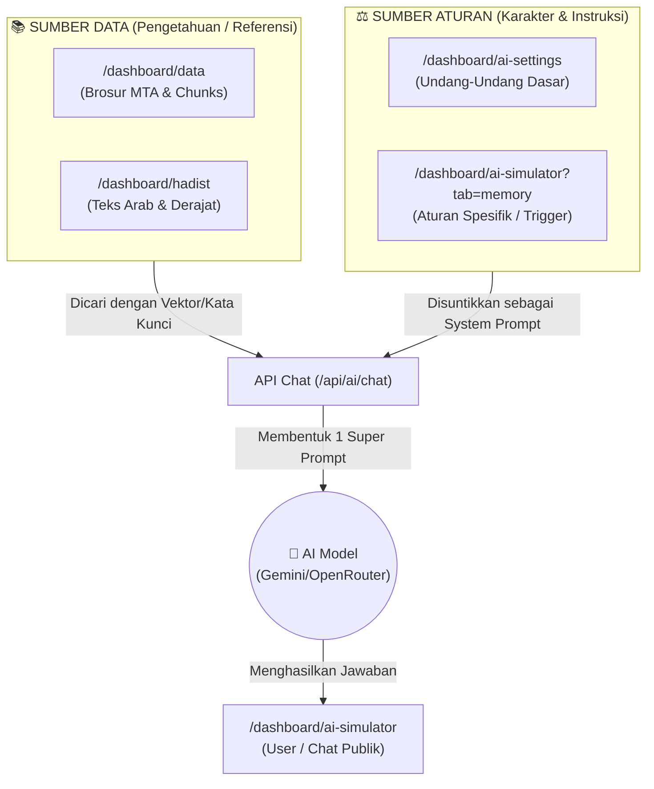

# Alur Referensi dan Aturan AI "Sahabat MTA"

Simulator AI (`/dashboard/ai-simulator`) bukanlah otak kosong. Ia adalah muara dari 4 (empat) sumber berbeda yang Anda atur melalui *dashboard*. Berikut adalah penjelasan bagaimana "ritme" atau alur kerja AI ini mengumpulkan referensi dan aturan sebelum menjawab pertanyaan pengguna.

---

## 1. Dari Mana AI Mengambil Referensi (Ilmu)?

Saat Anda bertanya, AI tidak boleh mengarang. Ia diwajibkan mencari referensi dari menu berikut:

### 📄 `/dashboard/data` (Basis Data Brosur Utama)
Ini adalah **urat nadi dan sumber utama** jawaban AI. Setiap PDF brosur yang Anda *upload* dan proses di menu Data akan disimpan ke *database* (`tabel brosur` dan `brosur_chunks`). Saat *user* bertanya (contoh: "hukum aqiqah"), sistem akan mencari paragraf brosur yang paling relevan dari menu ini, memotongnya, lalu memberikannya kepada AI untuk dibaca.

### 🕌 `/dashboard/hadist` (Kamus Spesifik)
*(Jika modul ini sudah aktif sepenuhnya)*, menu ini bertugas menyediakan kepastian penulisan teks Arab dan derajat hadits (Shahih, Dhaif, dll). Terkadang brosur hanya mengutip artinya saja, maka AI bisa dilatih untuk mengambil teks Arab aslinya secara akurat dari menu referensi Hadits ini.

---

## 2. Dari Mana AI Memperoleh "Aturan Main"?

Memiliki data saja tidak cukup, AI harus tahu **bagaimana cara menjawabnya** (Apakah galak? Lembut? Boleh menyimpulkan sendiri atau tidak?). Di sinilah 2 menu aturan bermain:

### ⚙️ `/dashboard/ai-settings` (Undang-Undang Dasar AI)
Menu ini adalah kontrol pusat. Di menu inilah teks instruksi masif dari **`sahabat-mta-prompt.md`** dihidupkan.
- **Tugasnya:** Menentukan bahwa AI harus selalu menyapa *"Saudaraku, Guru Daerah..."*, menentukan batas token, memilih model (OpenRouter/Gemini), dan aturan mutlak *"Jangan menjawab jika tidak ada di brosur!"*.

### 🧠 `/dashboard/ai-simulator?tab=memory` (Memori Khusus / Peraturan Daerah)
Menu ini berisi aturan penambal atau **"Instruksi Spesifik (*Few-Shot/Trigger*)"**.
- **Contoh Kasus:** Anda menyadari AI sering salah tangkap saat ditanya kata "Tahlilan" karena di brosur kata itu jarang disebut secara eksplisit.
- **Tugasnya:** Anda membuat Memori AI di menu ini: *"Jika keyword: Tahlilan, instruksikan AI untuk menghubungkannya dengan brosur tentang kematian dan peringatan hari ke-7."*
- Memori ini akan ikut disuntikkan secara dinamis saat ada *user* yang kebetulan mengetik kata yang memicu (*trigger*) memori tersebut.

---

## 3. Ritme Eksekusi (Detik demi Detik)

Saat Anda mengetik di Simulator, inilah yang terjadi di balik layar hanya dalam waktu 2 detik:
1. **Analisis Keyword:** Sistem membedah pertanyaan Anda.
2. **Tarik Memori (`tab=memory`):** Sistem mengecek apakah ada memori khusus yang cocok dengan pertanyaan tersebut.
3. **Pencarian Data (`/data` & `/hadist`):** Sistem berlari ke *database*, menarik 3 paragraf paling relevan dengan pertanyaan Anda.
4. **Penyusunan Aturan (`/ai-settings`):** Sistem membungkus 3 paragraf tadi dengan aturan UUD "Sahabat MTA".
5. **Kirim ke Otak Utama:** Semua paket itu dilempar ke AI (Gemini/OpenRouter).
6. **Balasan:** AI membalas tepat seperti yang diperintahkan, dan menampilkannya kembali ke layar **`/dashboard/ai-simulator`**.

Inilah alasan mengapa sistem RAG (Retrieval-Augmented Generation) Anda sangat cerdas dan terstruktur!
