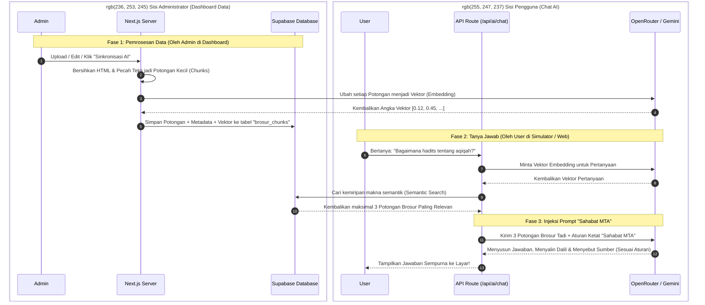

# Alur Kerja Sistem AI "Sahabat MTA" (RAG)

Diagram berikut menjelaskan bagaimana arsitektur AI Anda bekerja dari sisi penginputan data (Admin) hingga menghasilkan jawaban akurat untuk pengguna (User).

### 📋 Ringkasan Penjelasan Alur:

**1. Pemecahan Data (Di Belakang Layar Dashboard Data)**
Ketika Anda menyimpan brosur, sistem tidak lagi menyimpannya sebagai satu teks raksasa berukuran 15.000 karakter. Sistem memecahnya per paragraf (*chunking*). Paragraf yang membahas *Qurban* dipisah dengan paragraf yang membahas *Aqiqah*. Ini membuat *database* Supabase Anda jauh lebih cerdas.

**2. Pencarian Makna (Saat User Bertanya)**
Ketika *user* bertanya *"Hukum anak laki-laki potong domba"*, sistem tidak sekadar mencari kecocokan kata dasar (`indexOf` atau `ilike`), tetapi mencari **makna**. Supabase akan merogoh jutaan paragraf di tabel `brosur_chunks` dan hanya menarik **3 paragraf (maksimal)** yang maknanya paling menjawab pertanyaan itu.

**3. Eksekusi Jawaban Anti-Halusinasi (System Prompt)**
Di sinilah dokumen `sahabat-mta-prompt.md` mengambil alih kontrol secara absolut. AI (Gemini/OpenRouter) **"dikurung"** dan **dipaksa** untuk hanya melihat pada ke-3 paragraf tersebut.
- AI diwajibkan mengawali balasan dengan *"Saudaraku, Guru Daerah..."*
- AI dilarang keras mencomot dalil dari internet.
- AI wajib menyertakan Tahun dan Judul brosur di akhir jawaban.
- **Paling krusial:** Jika 3 paragraf yang ditarik dari *database* ternyata melenceng atau kosong, aturan *System Prompt* akan memaksa AI untuk jujur menjawab, *"Mohon maaf, tidak ada informasi tentang itu di database kami."*
